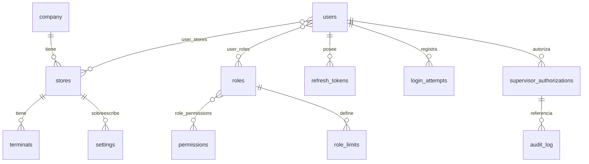
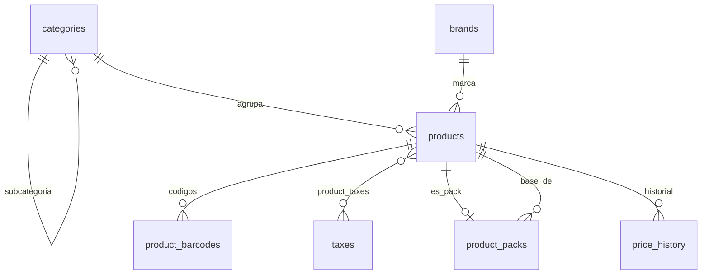
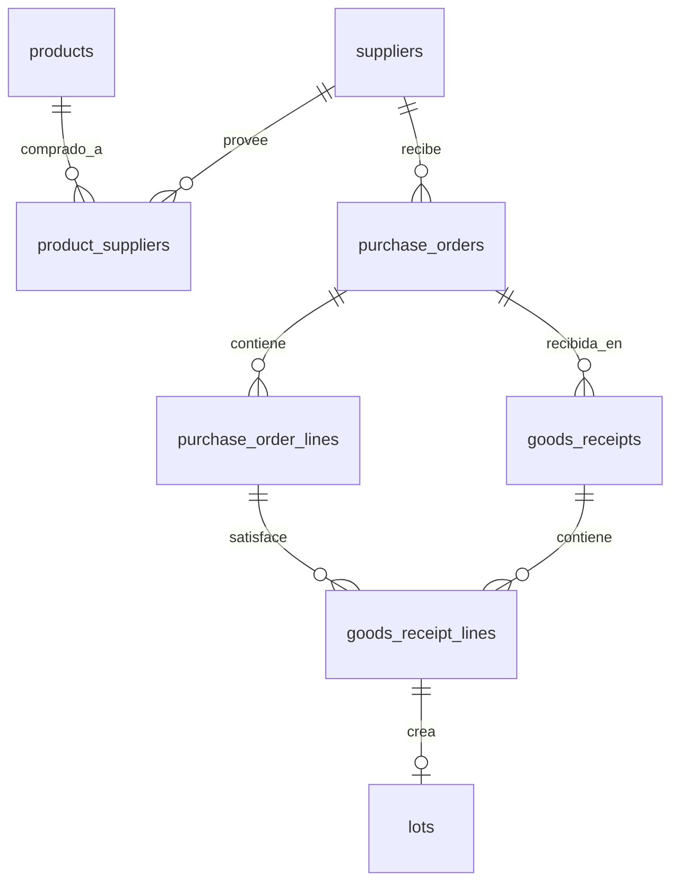
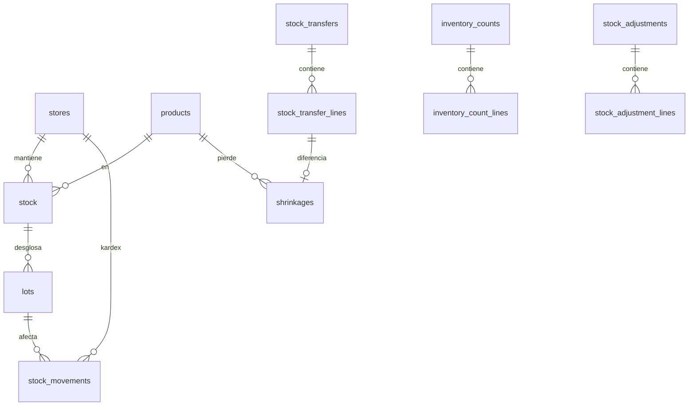
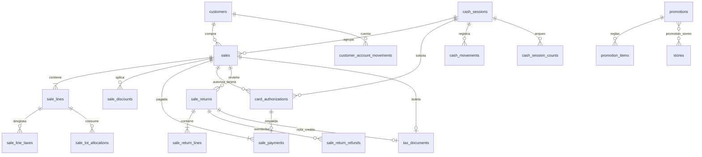
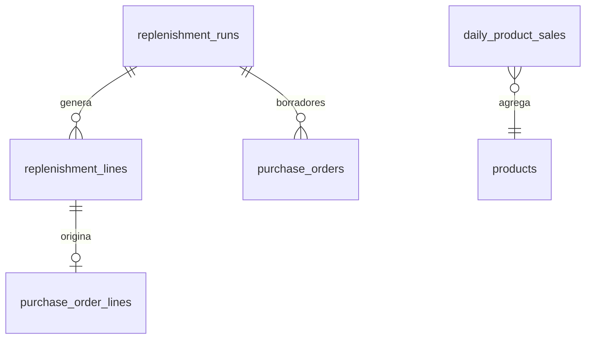

# Modelo de datos — POS Minimarket

> Parte del diseño de POS Minimarket. Las secciones conservan su letra (A–J) para que las referencias cruzadas funcionen entre documentos: A, C, E, H, I en [PLAN.md](PLAN.md) · B en [MODELO_DATOS.md](MODELO_DATOS.md) · D en [ROLES_PERMISOS.md](ROLES_PERMISOS.md) · F en [API.md](API.md) · G en [HISTORIAS_USUARIO.md](HISTORIAS_USUARIO.md).

## B. Modelo de datos

**Notación:**
- Cada tabla tiene `id bigint GENERATED ALWAYS AS IDENTITY` como PK, salvo que se indique otra cosa.
- Las columnas son **NOT NULL** salvo que lleven el sufijo `?`. `=x` indica default.
- FK: `→tabla` con ON DELETE RESTRICT por defecto; `[C]` = CASCADE, `[N]` = SET NULL.
- **AUD** = `created_at timestamptz =now(), created_by bigint?→users, updated_at timestamptz =now(), updated_by bigint?→users, version bigint =0` (JPA `@Version`).
- **APP** = append-only: solo `created_at timestamptz =now()` (+ `created_by` si aplica); sin UPDATE; DELETE solo donde se indica en "Borrado" (y en las purgas de B.13). Los permisos de BD de `pos_app` son SELECT/INSERT/UPDATE/DELETE por defecto; solo `audit_log` (sin UPDATE ni DELETE) y `stored_files` (solo UPDATE de `deleted_at`, sin DELETE) se restringen con REVOKE. En el resto de tablas APP la regla se cumple por diseño del código.
- **Borrado:** no hay borrado físico de maestros. Se usa `active boolean =true` (desactivar). El borrado físico se limita a:
  - lo que está en borrador: líneas de OC en DRAFT, líneas de recepciones y de transferencias en DRAFT, ventas suspendidas, ítems y locales de promoción;
  - roles sin usuarios (`DELETE /roles/{id}`), códigos de barras y parámetros de reabastecimiento (`DELETE` de sus endpoints);
  - los reemplazos de colección: `role_permissions`, `user_roles`, `user_stores`, `product_taxes` y `promotion_stores`/`promotion_items` se reescriben con DELETE + INSERT dentro de la misma transacción;
  - las purgas programadas de B.13 (`login_attempts`, `refresh_tokens`, `idempotency_keys`).

  **No se usa la columna soft-delete `deleted_at`**, con la única excepción de `stored_files` (limpieza de archivos huérfanos, ver B.1).
- Los enums son `varchar(30)` + CHECK con los valores de B.14.
- Extensiones: `pg_trgm`, `unaccent` y la función `f_unaccent(text)` IMMUTABLE.

### B.1 Organización y configuración

**company**: datos de la única empresa. AUD.
`rut varchar(12)`, `legal_name varchar(200)`, `trade_name varchar(200)`, `business_activity varchar(200)` (giro), `address varchar(250)`, `commune varchar(100)`, `city varchar(100)`, `phone varchar(30)?`, `email varchar(254)?`, `logo_file_id?→stored_files[N]`, `timezone varchar(40) ='America/Santiago'`, `currency char(3) ='CLP'`.
Índice único `uq_company_singleton ON company((true))`, que permite una sola fila. CK: el RUT válido se verifica en servicio.

**stores**: locales. AUD.
`company_id→company`, `code varchar(10)` UQ, `name varchar(120)`, `address varchar(250)`, `commune varchar(100)`, `city varchar(100)`, `phone varchar(30)?`, `sii_branch_code varchar(20)?`, `active bool =true`.
IX `(active)`.

**terminals**: cajas físicas. AUD.
`store_id→stores`, `code varchar(20)`, `name varchar(80)`, `active bool =true`, `last_seen_at timestamptz?`.
UQ `(store_id, code)`.

**settings**: parámetros clave-valor. AUD.
`scope varchar(10)` (GLOBAL|STORE), `store_id?→stores[C]`, `key varchar(100)`, `value jsonb`, `value_type varchar(10)` (STRING|NUMBER|BOOLEAN|JSON), `description varchar(250)?`.
CK `(scope='GLOBAL') = (store_id IS NULL)`. UQ parciales: `(key) WHERE store_id IS NULL`; `(key, store_id) WHERE store_id IS NOT NULL`.

Claves, valores por defecto, tipo, rango y alcance. `Scope` indica dónde se admite un valor: `GLOBAL` (solo la fila global) o `GLOBAL+STORE` (el local puede sobreescribir el global). Los valores se validan contra `value_type` y `Mín/Máx` en `PUT /settings/{key}` y en la semilla (HU-CFG-05):

| Clave | Default | Tipo | Mín/Máx | Scope |
|---|---|---|---|---|
| `pos.cash_rounding.enabled` | true | BOOLEAN | n/a | GLOBAL+STORE |
| `pos.suspended.max_per_terminal` | 5 | NUMBER | 1 a 20 | GLOBAL+STORE |
| `pos.suspended.ttl_hours` | 24 | NUMBER | 1 a 72 | GLOBAL+STORE |
| `pos.return.max_days` | 30 | NUMBER | 1 a 365 | GLOBAL+STORE |
| `ticket.header_lines` | [] | JSON (arreglo de string) | máx. 6 líneas de 48 caracteres | GLOBAL+STORE |
| `ticket.footer_lines` | [] | JSON (arreglo de string) | máx. 6 líneas de 48 caracteres | GLOBAL+STORE |
| `ticket.show_tax_breakdown` | true | BOOLEAN | n/a | GLOBAL+STORE |
| `ticket.paper_width_mm` | 80 | NUMBER | 58 a 80 | GLOBAL+STORE |
| `alerts.expiry.days_ahead` | 15 | NUMBER | 1 a 90 | GLOBAL+STORE |
| `cash.difference_tolerance` | 500 | NUMBER | 0 a 50000 | GLOBAL+STORE |
| `cash.default_opening_amount` | 50000 | NUMBER | 0 a 1000000 | GLOBAL+STORE |
| `security.password.min_length` | 10 | NUMBER | 8 a 64 | GLOBAL |
| `security.lockout.max_attempts` | 5 | NUMBER | 3 a 20 | GLOBAL |
| `security.lockout.minutes` | 15 | NUMBER | 1 a 1440 | GLOBAL |
| `security.pin.max_attempts` | 5 | NUMBER | 3 a 10 | GLOBAL |
| `security.pin.lockout_minutes` | 15 | NUMBER | 1 a 1440 | GLOBAL |
| `security.refresh.ttl_hours` | 12 | NUMBER | 1 a 72 | GLOBAL |
| `security.refresh.absolute_days` | 7 | NUMBER | 1 a 30 | GLOBAL |
| `email.ticket.enabled` | true | BOOLEAN | n/a | GLOBAL+STORE |

Si `pos.cash_rounding.enabled = false`, el `rounding_adjustment` de la venta es 0 y el efectivo se cobra exacto. La anulación (VOID) solo se permite con el turno original abierto (RN-12), sin configuración alternativa.

**document_sequences**: correlativos.
`sequence_type varchar(30)`, `store_id?→stores`, `prefix varchar(10)`, `next_value bigint =1`, `updated_at`.
UQ `(sequence_type, COALESCE(store_id,0))`. Se lee con `SELECT … FOR UPDATE`; el formato es `{prefix}-{next_value:08d}` (ej. `L01-V-00001234`).

**stored_files**: metadata de archivos. APP (excepto `deleted_at`).
`storage_key varchar(200)` UQ, `original_name varchar(255)`, `content_type varchar(100)`, `size_bytes bigint` (CK > 0), `sha256 char(64)`, `category varchar(30)`, `created_by?→users`, `deleted_at timestamptz?` (limpieza de huérfanos: solo archivos IMPORT y EXPORT con más de 30 días; única excepción a "sin soft delete").
Regla: se aceptan solo jpeg/png/webp/pdf/csv/xlsx según la categoría. Máximo 5 MB para imágenes y 20 MB para importaciones.

**import_jobs**: importaciones masivas. AUD.
`import_type varchar(30)`, `file_id→stored_files`, `status varchar(20)`, `dry_run bool =true`, `total_rows int =0`, `ok_rows int =0`, `error_rows int =0`, `errors jsonb?` (`[{row, field, message}]`), `finished_at timestamptz?`.

**outbound_emails**: outbox de correo. AUD.
`to_address varchar(254)`, `subject varchar(200)`, `template varchar(60)`, `payload jsonb`, `attachment_file_id?→stored_files`, `status varchar(10) ='PENDING'`, `attempts int =0`, `last_error text?`, `sent_at timestamptz?`.
IX `(status, created_at) WHERE status='PENDING'`.

**event_publication**: tabla técnica de Spring Modulith (registro de eventos). La crea una migración Flyway con el esquema oficial de la versión usada.

### B.2 Seguridad y auditoría

**users**: AUD.
`username varchar(50)`, `email varchar(254)?`, `full_name varchar(150)`, `rut varchar(12)?`, `password_hash varchar(100)`, `pin_hash varchar(100)?`, `pin_failed_attempts int =0`, `pin_locked bool =false`, `pin_locked_until timestamptz?` (auto-desbloqueo del PIN tras `security.pin.lockout_minutes`; se fija al bloquear y, vencido, el siguiente intento reinicia el contador), `failed_attempts int =0`, `locked_until timestamptz?`, `must_change_password bool =true`, `password_changed_at timestamptz =now()`, `last_login_at timestamptz?`, `active bool =true`.
UQ `lower(username)`, UQ `lower(email) WHERE email IS NOT NULL`, UQ `rut WHERE rut IS NOT NULL`.

**roles**: AUD.
`code varchar(30)` UQ, `name varchar(80)`, `description varchar(250)?`, `system bool =false` (los roles base no se borran, pero sus permisos sí se editan).

**permissions**: catálogo de solo lectura que se siembra por migración.
`code varchar(60)` UQ, `module varchar(30)`, `description varchar(250)`, `sensitive bool =false`.

**role_permissions**: PK `(role_id→roles[C], permission_id→permissions[C])`. APP.

**user_roles**: PK `(user_id→users[C], role_id→roles)`. APP.
El rol es global al usuario; el alcance lo da `user_stores`.

**user_stores**: PK `(user_id→users[C], store_id→stores)`, `is_default bool =false`, `updated_at timestamptz =now()`. Tabla actualizable: solo cambia `is_default`.
UQ `(user_id) WHERE is_default`.

**role_limits**: límites por rol. AUD.
`role_id→roles[C]`, `limit_code varchar(40)`, `value numeric(14,4)?` (NULL = sin límite, ∞).
UQ `(role_id, limit_code)`. CK `value IS NULL OR value >= 0`.
Semántica **fail-closed** (D.3): una fila ausente equivale a 0 (denegar); solo `value=NULL` es ∞. Al crear un rol se siembra una fila por cada `limit_code` de D.3 con `value=0`.

**refresh_tokens**:
`user_id→users[C]`, `token_hash char(64)` UQ, `family_id uuid`, `terminal_id?→terminals[N]` (se completa con `POST /auth/session/terminal` y se conserva al rotar), `issued_at timestamptz =now()`, `expires_at timestamptz`, `absolute_expires_at timestamptz`, `revoked_at timestamptz?`, `revoked_reason varchar(30)?` (ROTATED|LOGOUT|REUSE_DETECTED|ADMIN|USER_DISABLED), `replaced_by_id?→refresh_tokens[N]`, `ip inet?`, `user_agent varchar(300)?`.
IX `(user_id) WHERE revoked_at IS NULL`, IX `(family_id)`, IX `(expires_at)` para la purga.

**login_attempts**: APP (purga a los 90 días).
`username varchar(50)`, `user_id?→users[N]`, `method varchar(10)`, `ip inet?`, `success bool`, `failure_reason varchar(30)?` (BAD_CREDENTIALS|LOCKED|DISABLED|PIN_LOCKED|RATE_LIMITED), `attempted_at timestamptz =now()`.
IX `(lower(username), attempted_at DESC)`, IX `(ip, attempted_at DESC)`.

**supervisor_authorizations**: overrides. Se actualiza solo `consumed_at`.
`action varchar(40)`, `status varchar(10)` (GRANTED|DENIED), `requested_by→users`, `authorized_by?→users`, `store_id→stores`, `terminal_id?→terminals`, `method varchar(10)`, `context jsonb`, `context_hash char(64)`, `token_hash char(64)?` UQ, `expires_at timestamptz?`, `consumed_at timestamptz?`, `entity_type varchar(40)?`, `entity_id varchar(40)?` (se completa al consumir), `reason varchar(250)?`, `created_at`.
CK `authorized_by IS NULL OR authorized_by <> requested_by`. IX `(store_id, created_at DESC)`, IX `(authorized_by, created_at DESC)`.

**audit_log**: APP inmutable.
`occurred_at timestamptz =now()`, `user_id?→users`, `username varchar(50)`, `store_id?`, `terminal_id?`, `ip inet?`, `action varchar(60)`, `entity_type varchar(40)`, `entity_id varchar(40)`, `old_value jsonb?`, `new_value jsonb?`, `reason varchar(500)?`, `authorization_id?→supervisor_authorizations`, `trace_id varchar(40)?`, `prev_hash char(64)?`, `hash char(64)`.
IX `(entity_type, entity_id)`, `(action, occurred_at DESC)`, `(user_id, occurred_at DESC)`, `(store_id, occurred_at DESC)`.
Trigger `trg_audit_log_immutable`: BEFORE UPDATE OR DELETE lanza RAISE EXCEPTION. Sobre esta tabla, `pos_app` conserva solo INSERT y SELECT (la migración hace REVOKE de UPDATE y DELETE sobre el grant por defecto). El cálculo del hash se serializa con `pg_advisory_xact_lock(hashtext('audit_log'))`.

**idempotency_keys**:
`idem_key uuid`, `user_id→users`, `endpoint varchar(100)`, `request_hash char(64)`, `status varchar(15)`, `response_status int?`, `response_body jsonb?`, `resource_type varchar(40)?`, `resource_id bigint?`, `created_at`, `expires_at`.
UQ `(user_id, endpoint, idem_key)`. IX `(expires_at)`.

### B.3 Catálogo

**categories**: dos niveles (categoría y subcategoría). AUD.
`parent_id?→categories`, `name varchar(100)`, `code varchar(20)?`, `active bool =true`.
UQ `(COALESCE(parent_id,0), lower(name))`. Regla de servicio: el padre no puede tener a su vez padre.

**brands**: AUD.
`name varchar(100)`, `active bool =true`. UQ `lower(name)`.

**taxes**: AUD.
`code varchar(30)` UQ (IVA, ILA_DESTILADOS, ILA_VINOS_CERVEZAS, ILA_BEBIDAS_ANALCOHOLICAS, ILA_BEBIDAS_ALTO_AZUCAR), `name varchar(100)`, `tax_type varchar(15)` (VAT|ADDITIONAL), `rate numeric(7,4)` (CK 0 ≤ rate ≤ 100), `sii_code varchar(10)?`, `valid_from date`, `valid_to date?`, `active bool =true`.
Valores de semilla, a verificar contra la normativa vigente: IVA 19; destilados 31,5; vinos y cervezas 20,5; analcohólicas 10; alto en azúcar 18.

**products**: AUD.
`sku varchar(40)` UQ, `name varchar(200)`, `description text?`, `brand_id?→brands`, `category_id→categories`, `sale_type varchar(10)`, `unit_of_measure varchar(5)`, `price_gross numeric(12,0) =0` (precio con impuestos; en pesables, por kg), `avg_cost numeric(14,4) =0`, `last_cost numeric(14,4)?`, `vat_exempt bool =false`, `restricted_type varchar(10)?`, `lot_controlled bool =false`, `shelf_life_days int?`, `image_file_id?→stored_files[N]`, `shortcut_code varchar(10)?`, `allow_manual_discount bool =true`, `active bool =true`.
CK:
- `price_gross >= 0`, `avg_cost >= 0`;
- `(sale_type='WEIGHT') = (unit_of_measure='KG')`;
- `sale_type <> 'PACK' OR lot_controlled = false`;
- `shelf_life_days IS NULL OR shelf_life_days > 0`.
UQ `shortcut_code WHERE shortcut_code IS NOT NULL`. IX GIN `(f_unaccent(lower(name)) gin_trgm_ops)`, IX `(category_id)`, `(brand_id)`, `(active)`.

**product_barcodes**: AUD.
`product_id→products[C]`, `code varchar(20)`, `barcode_type varchar(10)`, `is_primary bool =false`.
UQ `(code) WHERE barcode_type <> 'SCALE_PLU'`; UQ `(code) WHERE barcode_type = 'SCALE_PLU'`; UQ `(product_id) WHERE is_primary`. CK: los dígitos verificadores de EAN13 y EAN8 se validan en servicio. `SCALE_PLU` se permite solo en productos WEIGHT o cuando la balanza embebe precio.

**product_packs**: PK `product_id→products[C]` (el pack), `base_product_id→products`, `factor numeric(12,3)`.
CK `factor > 0 AND factor = trunc(factor)`, `product_id <> base_product_id`. IX `(base_product_id)`. Regla de servicio: el base es un producto UNIT y no es pack.

**product_taxes**: PK `(product_id→products[C], tax_id→taxes)`. APP.
Regla: el IVA se asigna por defecto. `vat_exempt=true` implica que el producto **no** tiene el IVA en `product_taxes` (sí puede tener impuestos ADDITIONAL). `vat_exempt` y el conjunto de `product_taxes` se cambian solo con `PUT /products/{id}/taxes` (`config:tax:manage`, auditado como PRODUCT_TAXES_CHANGED); al crear, apartarse del IVA por defecto exige el mismo permiso.

**price_history**: APP.
`product_id→products`, `change_type varchar(20)`, `old_price_gross numeric(12,0)?`, `new_price_gross numeric(12,0)?`, `old_cost numeric(14,4)?`, `new_cost numeric(14,4)?`, `source_type varchar(30)?`, `source_id bigint?`, `reason varchar(250)?`, `changed_by?→users`, `changed_at timestamptz =now()`.
IX `(product_id, changed_at DESC)`.

**scale_barcode_configs**: AUD.
`name varchar(60)`, `prefix varchar(3)` UQ (ej. "20"–"29"), `embedded_type varchar(10)` (PRICE|WEIGHT), `plu_start smallint`, `plu_length smallint`, `value_start smallint`, `value_length smallint`, `value_decimals smallint` (peso: 3; precio: 0), `active bool =true`.
CK `plu_start + plu_length <= 13`, `value_start + value_length <= 13`. Regla: se verifica el dígito verificador del EAN-13. La cantidad es el peso embebido, o bien `precio_embebido / price_gross` redondeado a 3 decimales.

### B.4 Proveedores y compras

**suppliers**: AUD.
`rut varchar(12)` UQ, `legal_name varchar(200)`, `trade_name varchar(200)?`, `business_activity varchar(200)?`, `address varchar(250)?`, `commune varchar(100)?`, `city varchar(100)?`, `phone varchar(30)?`, `email varchar(254)?`, `contact_name varchar(150)?`, `contact_phone varchar(30)?`, `contact_email varchar(254)?`, `payment_terms_type varchar(20)`, `payment_terms_days int =0`, `lead_time_days int =1`, `delivery_weekdays smallint[] ='{}'` (ISO 1–7), `notes text?`, `active bool =true`.
CK `lead_time_days >= 0`, `payment_terms_days >= 0`, `delivery_weekdays <@ '{1,2,3,4,5,6,7}'`.

**product_suppliers**: AUD.
`product_id→products`, `supplier_id→suppliers`, `supplier_sku varchar(40)?`, `purchase_unit_name varchar(30) ='Unidad'`, `units_per_purchase_unit numeric(12,3) =1`, `cost_per_purchase_unit numeric(14,4)` (neto), `min_order_qty numeric(12,3) =1` (en unidades de compra), `lead_time_days_override int?`, `is_preferred bool =false`, `last_purchase_at timestamptz?`, `active bool =true`.
UQ `(product_id, supplier_id)`; UQ `(product_id) WHERE is_preferred AND active`. CK `units_per_purchase_unit > 0`, `cost_per_purchase_unit >= 0`, `min_order_qty >= 1`. Regla: el producto no es PACK.

**purchase_orders**: AUD.
`number varchar(24)` UQ, `store_id→stores`, `supplier_id→suppliers`, `status varchar(20) ='DRAFT'`, `origin varchar(15) ='MANUAL'`, `replenishment_run_id?→replenishment_runs[N]`, `expected_date date?`, `sent_at timestamptz?`, `sent_by?→users`, `cancelled_at timestamptz?`, `cancel_reason varchar(250)?`, `notes text?`, `net_total numeric(14,0) =0`, `tax_total numeric(14,0) =0`, `total numeric(14,0) =0`.
IX `(store_id, status)`, `(supplier_id, created_at DESC)`.
Totales: `net_total = Σ line_net_total`; `tax_total = Σ round(line_net_total × tasa IVA vigente / 100, 0)` (la tasa del impuesto VAT vigente a la fecha de la OC, sumada por línea); `total = net_total + tax_total`.

**purchase_order_lines**: AUD.
`purchase_order_id→purchase_orders[C]`, `product_id→products`, `product_supplier_id?→product_suppliers[N]`, `qty_purchase_units numeric(12,3)`, `units_per_purchase_unit numeric(12,3)`, `qty_ordered numeric(14,3)` (base), `unit_cost_net numeric(14,4)` (por unidad base), `qty_received numeric(14,3) =0`, `line_net_total numeric(14,0)`, `replenishment_line_id?→replenishment_lines[N]`.
UQ `(purchase_order_id, product_id)`. CK `qty_purchase_units > 0`, `qty_received >= 0`, `qty_ordered = round(qty_purchase_units * units_per_purchase_unit, 3)` (el producto de dos `numeric(_,3)` tiene hasta 6 decimales).

**goods_receipts**: AUD.
`number varchar(24)` UQ, `purchase_order_id?→purchase_orders`, `store_id→stores`, `supplier_id→suppliers`, `status varchar(15) ='DRAFT'`, `supplier_document_type varchar(20)`, `supplier_document_number varchar(30)?`, `received_at timestamptz?`, `received_by?→users`, `net_total numeric(14,0) =0`, `notes text?`.
IX `(store_id, received_at DESC)`, `(purchase_order_id)`.

**goods_receipt_lines**: AUD.
`goods_receipt_id→goods_receipts[C]`, `purchase_order_line_id?→purchase_order_lines`, `product_id→products`, `qty_expected numeric(14,3)?`, `qty_received numeric(14,3)`, `qty_rejected numeric(14,3) =0`, `difference_reason varchar(250)?`, `unit_cost_net numeric(14,4)`, `lot_number varchar(40)?`, `expiry_date date?`, `lot_id?→lots`.
CK `qty_received >= 0`, `qty_rejected >= 0`, `qty_rejected <= qty_received`.
Regla: al confirmar, el stock, el lote y el costo promedio usan `qty_received − qty_rejected`; lo rechazado no entra al stock (A.5).

### B.5 Inventario

**stock**: PK `(store_id→stores, product_id→products)`.
`quantity numeric(14,3) =0`, `min_qty numeric(14,3)?`, `max_qty numeric(14,3)?`, `last_movement_at timestamptz?`, `updated_at`.
CK `quantity >= 0` (**RN-01**), `min_qty IS NULL OR min_qty >= 0`, `max_qty IS NULL OR min_qty IS NULL OR max_qty >= min_qty`.
IX `(product_id)`; IX parcial `(store_id) WHERE min_qty IS NOT NULL AND quantity <= min_qty` (alertas).
Sin `@Version`: se modifica solo por UPDATE condicional. Solo existen filas de productos no PACK; se crean al crear el producto, para cada local activo.

**lots**: AUD.
`store_id→stores`, `product_id→products`, `lot_number varchar(40)`, `expiry_date date?`, `quantity numeric(14,3) =0`, `unit_cost numeric(14,4)?`, `received_at timestamptz`, `goods_receipt_line_id?→goods_receipt_lines[N]`, `status varchar(10) ='ACTIVE'`.
CK `quantity >= 0`. UQ `(store_id, product_id, lot_number, COALESCE(expiry_date,'infinity'))`. IX parcial `(store_id, product_id, expiry_date NULLS LAST, id) WHERE quantity > 0` (FEFO); IX `(expiry_date) WHERE quantity > 0` (alertas).

**stock_movements** (kardex): APP.
`store_id→stores`, `product_id→products`, `lot_id?→lots`, `movement_type varchar(25)`, `quantity_delta numeric(14,3)`, `balance_after numeric(14,3)`, `unit_cost numeric(14,4)`, `source_type varchar(30)`, `source_id bigint`, `source_line_id bigint?`, `reason varchar(250)?`, `user_id→users`, `occurred_at timestamptz =now()`.
CK `quantity_delta <> 0`, `balance_after >= 0`. IX `(store_id, product_id, occurred_at DESC)`, `(source_type, source_id)`, `(movement_type, occurred_at)`. Futuro: particionar por mes.

**stock_adjustments**: ajustes manuales fuera de una toma. AUD.
`number varchar(24)` UQ, `store_id→stores`, `reason_code varchar(30)`, `notes varchar(500)?`, `status varchar(20)`, `total_cost_impact numeric(16,2)`, `requested_by→users`, `approved_by?→users`, `approved_at timestamptz?`, `rejection_reason varchar(250)?`.
CK `approved_by IS NULL OR approved_by <> requested_by`. IX `(store_id, status)`.

**stock_adjustment_lines**: `adjustment_id→stock_adjustments[C]`, `product_id→products`, `lot_id?→lots`, `quantity_delta numeric(14,3)` (CK ≠ 0), `unit_cost numeric(14,4)`, `stock_movement_id?→stock_movements`.

**inventory_counts**: AUD.
`number varchar(24)` UQ, `store_id→stores`, `count_type varchar(10)`, `category_id?→categories`, `status varchar(15) ='OPEN'`, `blind bool =true`, `started_by→users`, `submitted_by?→users`, `submitted_at timestamptz?`, `approved_by?→users`, `approved_at timestamptz?`, `rejection_reason varchar(250)?`, `notes text?`.
CK `(count_type='CYCLIC') = (category_id IS NOT NULL)`. UQ parcial `(store_id, COALESCE(category_id,0)) WHERE status IN ('OPEN','SUBMITTED')`.

**inventory_count_lines**: AUD.
`count_id→inventory_counts[C]`, `product_id→products`, `lot_id?→lots`, `theoretical_qty numeric(14,3)?` (stock en el instante del conteo), `counted_qty numeric(14,3)?`, `unit_cost numeric(14,4)?`, `counted_by?→users`, `counted_at timestamptz?`, `stock_movement_id?→stock_movements`.
UQ `(count_id, product_id, COALESCE(lot_id,0))`. CK `counted_qty IS NULL OR counted_qty >= 0`.
Regla: al aprobar se aplica `delta = counted_qty − theoretical_qty` **como delta**, de modo que las ventas ocurridas durante la toma se conservan.

**stock_transfers**: AUD.
`number varchar(24)` UQ, `origin_store_id→stores`, `destination_store_id→stores`, `status varchar(15) ='DRAFT'`, `sent_at?`, `sent_by?→users`, `received_at?`, `received_by?→users`, `notes text?`.
CK `origin_store_id <> destination_store_id`. IX `(destination_store_id, status)`, `(origin_store_id, status)`.

**stock_transfer_lines**: AUD.
`transfer_id→stock_transfers[C]`, `product_id→products`, `origin_lot_id?→lots`, `lot_number varchar(40)?`, `expiry_date date?`, `qty_sent numeric(14,3)`, `qty_received numeric(14,3)?`, `difference_reason varchar(250)?`, `unit_cost numeric(14,4)`.
CK `qty_sent > 0`, `qty_received IS NULL OR qty_received BETWEEN 0 AND qty_sent`.

### B.6 Mermas

**shrinkages**: AUD.
`number varchar(24)` UQ, `store_id→stores`, `product_id→products`, `lot_id?→lots`, `shrinkage_type varchar(25)`, `quantity numeric(14,3)`, `unit_cost numeric(14,4)`, `total_cost numeric(16,2)`, `reason varchar(500)?`, `evidence_file_id?→stored_files[N]`, `responsible_user_id→users`, `reported_by→users`, `status varchar(20)`, `approved_by?→users`, `approved_at?`, `rejection_reason varchar(250)?`, `transfer_line_id?→stock_transfer_lines`, `sale_return_line_id bigint?→sale_return_lines`, `auto_approved boolean =false`, `affects_stock boolean =true`, `stock_movement_id?→stock_movements`, `occurred_at timestamptz`.
CK `quantity > 0`, `approved_by IS NULL OR approved_by <> reported_by`, `shrinkage_type <> 'TRANSFER_DIFFERENCE' OR affects_stock = false`, `status <> 'APPROVED' OR approved_by IS NOT NULL OR auto_approved`, `affects_stock OR transfer_line_id IS NOT NULL OR sale_return_line_id IS NOT NULL`. IX `(store_id, occurred_at)`, `(product_id, occurred_at)`, `(shrinkage_type, occurred_at)`, `(status) WHERE status='PENDING_APPROVAL'`.
Regla: la autoaprobación (RN-21) exige `total_cost > 0`, deja `approved_by` en NULL con `auto_approved=true`, para no violar el CK `approved_by <> reported_by`. **Una merma con `affects_stock=false` (TRANSFER_DIFFERENCE o devolución sin reingreso) nunca genera movimiento al aprobarse.**

**Mermas sistémicas** (`affects_stock=false`, creadas por el sistema y no por `POST /shrinkages`):
- Nacen siempre en `PENDING_APPROVAL`: no hay autoaprobación (`auto_approved=false`).
- `reported_by` es quien recibe la transferencia o quien registra la devolución, y `responsible_user_id` es el mismo usuario. El CK `approved_by <> reported_by` impide que se apruebe a sí mismo.
- `lot_id` se copia de la línea de origen (`stock_transfer_lines.origin_lot_id` o el lote de `sale_lot_allocations` de la línea devuelta). El origen se enlaza con `transfer_line_id` (TRANSFER_DIFFERENCE) o `sale_return_line_id` (DAMAGED por devolución sin reingreso).
- Un REJECTED es solo una anotación y no tiene efecto en el stock; los reportes de merma cuentan solo las APPROVED.
- Los aprobadores se resuelven por el `store_id` de la merma (el local de origen en una transferencia, el local de la devolución), no por el local de quien la dispara.

### B.7 Clientes y cuenta corriente

**customers**: AUD.
`rut varchar(12)?`, `name varchar(150)`, `email varchar(254)?`, `phone varchar(30)?`, `address varchar(250)?`, `credit_enabled bool =false`, `credit_limit numeric(14,0) =0`, `credit_balance numeric(14,0) =0` (deuda), `notes text?`, `active bool =true`.
UQ `rut WHERE rut IS NOT NULL`. CK `credit_limit >= 0`, `credit_balance >= 0`. IX trigram sobre `name`.

**customer_account_movements**: APP.
`customer_id→customers`, `store_id→stores`, `movement_type varchar(15)`, `amount numeric(14,0)` (+ aumenta deuda; CK ≠ 0), `balance_after numeric(14,0)` (CK ≥ 0), `sale_id?→sales`, `sale_return_id?→sale_returns`, `payment_method varchar(20)?`, `cash_session_id?→cash_sessions`, `user_id→users`, `idempotency_key uuid?` UQ (los abonos son [I]), `notes varchar(250)?`, `occurred_at =now()`.
IX `(customer_id, occurred_at DESC)`, `(cash_session_id)`.

### B.8 Caja y turnos

**cash_sessions**: AUD.
`number varchar(24)` UQ, `store_id→stores`, `terminal_id→terminals`, `cashier_user_id→users`, `status varchar(10) ='OPEN'`, `business_date date`, `opened_at =now()`, `opening_amount numeric(14,0)`, `closed_at?`, `closed_by?→users`, `expected_total numeric(14,0)?`, `counted_total numeric(14,0)?`, `difference_total numeric(14,0)?`, `difference_approved_by?→users`, `difference_approved_at?`, `closing_notes varchar(500)?`.
UQ `(terminal_id) WHERE status='OPEN'`; UQ `(cashier_user_id) WHERE status='OPEN'`. CK `opening_amount >= 0`, `difference_approved_by IS NULL OR difference_approved_by <> cashier_user_id`. IX `(store_id, business_date)`, `(cashier_user_id, business_date)`.

**cash_movements**: APP.
`cash_session_id→cash_sessions`, `movement_type varchar(10)` (CASH_IN|CASH_OUT), `amount numeric(14,0)` (CK > 0), `reason varchar(250)`, `authorization_id?→supervisor_authorizations`, `user_id→users`, `idempotency_key uuid` UQ, `occurred_at =now()`.

**cash_session_counts**: arqueo. APP (se escribe al cerrar).
`cash_session_id→cash_sessions[C]`, `payment_method varchar(20)`, `expected_amount numeric(14,0)`, `counted_amount numeric(14,0)`, `difference numeric(14,0)`, `denomination_detail jsonb?`, `notes varchar(250)?`.
UQ `(cash_session_id, payment_method)`. CK `difference = counted_amount − expected_amount`.

Fórmula del esperado en efectivo: `opening + Σ CASH_IN − Σ CASH_OUT + Σ CashFlowContributor[CASH]` (Σ `sale_payments.amount` de los pagos CASH, que ya es neto de vuelto y del redondeo, menos reembolsos en efectivo, más abonos en efectivo).

### B.9 Ventas

**sales**: AUD.
`number varchar(24)` UQ, `store_id→stores`, `terminal_id→terminals`, `cash_session_id→cash_sessions`, `cashier_user_id→users`, `customer_id?→customers`, `status varchar(20) ='COMPLETED'`, `sold_at =now()`, `business_date date`, `idempotency_key uuid` UQ, `subtotal_gross numeric(14,0)`, `discount_total numeric(14,0) =0`, `total_gross numeric(14,0)`, `net_total numeric(14,0)`, `tax_total numeric(14,0)`, `exempt_total numeric(14,0) =0`, `rounding_adjustment numeric(4,0) =0`, `total_payable numeric(14,0)`, `paid_total numeric(14,0)`, `change_total numeric(14,0) =0`, `age_confirmed bool =false`, `email_to varchar(254)?`.
CK:
- `total_gross = subtotal_gross − discount_total`;
- `net_total + tax_total + exempt_total = total_gross`;
- `rounding_adjustment BETWEEN -5 AND 4`;
- `total_payable = total_gross + rounding_adjustment`;
- `paid_total − change_total = total_payable`.
Semántica de pagos: `paid_total = Σ COALESCE(sale_payments.tendered_amount, sale_payments.amount)` (lo que entregó el cliente) y `change_total = Σ sale_payments.change_amount`. Además `Σ sale_payments.amount = total_payable` (RN-07).
IX `(store_id, business_date)`, `(cash_session_id)`, `(cashier_user_id, business_date)`, `(customer_id) WHERE customer_id IS NOT NULL`.

**sale_lines**: APP (excepto `returned_quantity`).
`sale_id→sales[C]`, `line_number smallint`, `store_id`, `business_date date` (desnormalizados), `product_id→products`, `sku varchar(40)`, `product_name varchar(200)` (snapshot), `scanned_code varchar(20)?`, `sale_type varchar(10)`, `quantity numeric(14,3)`, `stock_product_id→products` (base si es pack), `stock_quantity numeric(14,3)` (= qty × factor), `unit_price_gross numeric(12,0)`, `line_subtotal_gross numeric(14,0)`, `discount_amount numeric(14,0) =0` (manual + promo + prorrateo), `line_total_gross numeric(14,0)`, `line_net numeric(14,0)`, `line_tax numeric(14,0)`, `line_exempt numeric(14,0) =0`, `unit_cost numeric(14,4)`, `line_cost numeric(16,2)`, `restricted bool =false`, `returned_quantity numeric(14,3) =0`.
UQ `(sale_id, line_number)`. CK `quantity > 0`, `line_total_gross = line_subtotal_gross − discount_amount`, `line_total_gross >= 0`, `line_net + line_tax + line_exempt = line_total_gross`, `returned_quantity BETWEEN 0 AND quantity`. IX `(store_id, business_date, product_id)`, `(stock_product_id, business_date)`.

**sale_line_taxes**: APP.
`sale_line_id→sale_lines[C]`, `tax_id→taxes`, `tax_code varchar(30)`, `rate numeric(7,4)`, `base_amount numeric(14,0)`, `tax_amount numeric(14,0)`.
UQ `(sale_line_id, tax_id)`.

**sale_discounts**: APP.
`sale_id→sales[C]`, `sale_line_id?→sale_lines[C]` (NULL = al total), `source varchar(10)`, `promotion_id?→promotions`, `discount_kind varchar(10)`, `value numeric(12,4)`, `amount numeric(14,0)` (CK > 0), `reason varchar(250)?`, `applied_by→users`, `authorization_id?→supervisor_authorizations`.
CK `(source='PROMOTION') = (promotion_id IS NOT NULL)`. IX `(promotion_id)`.

**sale_payments**: APP (excepto `status`).
`sale_id→sales[C]`, `method varchar(20)`, `amount numeric(14,0)` (CK > 0; monto **aplicado** a la venta; en efectivo = entregado − vuelto, ya con el redondeo del efectivo), `tendered_amount numeric(14,0)?` (monto entregado; solo CASH), `change_amount numeric(14,0) =0` (vuelto; solo CASH), `status varchar(10) ='APPROVED'`, `gateway_reference varchar(60)?`, `authorization_code varchar(20)?`, `card_brand varchar(20)?`, `card_last4 char(4)?`, `transfer_reference varchar(60)?`, `card_authorization_id?→card_authorizations`.
CK `method <> 'CASH' OR tendered_amount >= amount`, `(method = 'CASH') = (tendered_amount IS NOT NULL)`, `change_amount = COALESCE(tendered_amount, amount) − amount`, `card_last4 ~ '^[0-9]{4}$'`. UQ parcial `(card_authorization_id) WHERE card_authorization_id IS NOT NULL`. Nunca se guarda el PAN.

**card_authorizations**: autorizaciones de tarjeta pedidas a la pasarela antes de cerrar la venta. AUD.
`store_id→stores`, `terminal_id→terminals`, `cash_session_id→cash_sessions`, `method varchar(10)` (DEBIT|CREDIT), `amount numeric(14,0)` (CK > 0), `idempotency_key uuid` UQ, `status varchar(15)`, `gateway_reference varchar(60)?`, `authorization_code varchar(20)?`, `card_brand varchar(20)?`, `card_last4 char(4)?`, `sale_id?→sales`, `message varchar(250)?`.
IX `(status) WHERE status='APPROVED' AND sale_id IS NULL`.

**sale_lot_allocations**: APP.
`sale_line_id→sale_lines[C]`, `lot_id→lots`, `quantity numeric(14,3)` (CK > 0).

**suspended_sales**: AUD.
`store_id→stores`, `terminal_id→terminals`, `user_id→users`, `label varchar(60)?`, `customer_id?→customers`, `cart jsonb` (`{schemaVersion, lines:[{productId, qty, scannedCode, manualDiscount}], totalDiscount}`), `expires_at timestamptz`.
IX `(terminal_id, created_at)`. Se borran físicamente al retomar o expirar. No afectan stock.

**sale_returns** (anulación o devolución): APP.
`number varchar(24)` UQ, `sale_id→sales`, `return_type varchar(10)` (VOID|RETURN), `store_id`, `terminal_id`, `cash_session_id→cash_sessions`, `reason_code varchar(30)`, `reason_text varchar(500)?`, `refund_total numeric(14,0)`, `authorization_id?→supervisor_authorizations`, `idempotency_key uuid` UQ, `created_by→users`, `created_at`.
IX `(sale_id)`, `(store_id, created_at)`.

**sale_return_lines**: APP.
`sale_return_id→sale_returns[C]`, `sale_line_id→sale_lines`, `quantity numeric(14,3)` (CK > 0), `stock_quantity numeric(14,3)`, `restock bool =true`, `refund_amount numeric(14,0)` (proporcional a `line_total_gross`), `refund_net numeric(14,0)`, `refund_tax numeric(14,0)`.
Regla: si `restock=false` se crea una merma DAMAGED pendiente (merma sistémica con `affects_stock=false` y `sale_return_line_id`, ver B.6).

**sale_return_refunds**: APP.
`sale_return_id→sale_returns[C]`, `method varchar(20)`, `amount numeric(14,0)` (CK > 0), `gateway_reference varchar(60)?`.

**tax_documents**: AUD.
`store_id→stores`, `document_type varchar(20)`, `sii_type_code smallint` (39|41|61), `folio bigint`, `sale_id?→sales`, `sale_return_id?→sale_returns`, `referenced_document_id?→tax_documents`, `status varchar(10) ='PENDING'`, `provider varchar(30)`, `provider_track_id varchar(60)?`, `net_amount numeric(14,0)`, `exempt_amount numeric(14,0)`, `tax_amount numeric(14,0)`, `total_amount numeric(14,0)`, `payload jsonb`, `attempts int =0`, `last_error text?`, `issued_at?`.
UQ `(document_type, folio)`. CK `num_nonnulls(sale_id, sale_return_id) = 1`. IX `(status) WHERE status IN ('PENDING','ERROR')`, `(sale_id)`.

### B.10 Promociones

**promotions**: AUD.
`name varchar(120)`, `description varchar(500)?`, `promotion_type varchar(20)`, `priority int =100`, `stackable bool =false`, `valid_from timestamptz`, `valid_to timestamptz?`, `days_of_week smallint[]?`, `time_from time?`, `time_to time?`, `all_stores bool =true`, `percent numeric(7,4)?`, `amount numeric(14,0)?`, `buy_qty int?`, `pay_qty int?`, `min_qty numeric(12,3)?`, `combo_price numeric(14,0)?`, `max_applications_per_sale int?`, `active bool =true`.
CK por tipo:
- PERCENT ⇒ `percent` en (0,100];
- FIXED_AMOUNT ⇒ `amount > 0`;
- BUY_X_PAY_Y ⇒ `buy_qty > pay_qty >= 1`;
- QUANTITY_PRICE ⇒ `min_qty > 0 AND amount > 0` (precio unitario desde N);
- COMBO ⇒ `combo_price > 0`.
Además, `valid_to IS NULL OR valid_to > valid_from`. IX `(active, valid_from, valid_to)`.

**promotion_stores**: PK `(promotion_id→promotions[C], store_id→stores)`.

**promotion_items**: `promotion_id→promotions[C]`, `target_type varchar(10)`, `product_id?→products`, `category_id?→categories`, `brand_id?→brands`, `required_qty numeric(12,3) =1`.
CK `num_nonnulls(product_id, category_id, brand_id) = 1` y coherente con `target_type`. Los COMBO solo usan PRODUCT. IX `(product_id)`, `(category_id)`, `(brand_id)`.

Regla del motor: se evalúan las vigentes del local y la hora y se aplican por `priority` ascendente. Las no acumulables toman, por línea, la de **mayor beneficio** para el cliente. Una línea con promoción no acepta un descuento manual de línea salvo override.

### B.11 Reabastecimiento y agregados

**replenishment_params**: AUD.
`scope varchar(10)`, `store_id?→stores`, `category_id?→categories`, `product_id?→products`, más los parámetros de C.2 en columnas anulables (`window_days int?`, `min_history_days int?`, `service_level_z numeric(5,3)?`, `safety_min_days numeric(6,2)?`, `review_period_days int?`, `outlier_k numeric(5,2)?`, `shelf_life_factor numeric(4,3)?`, `enabled bool?`).
CK de coherencia entre el scope y sus FK. UQ `(scope, COALESCE(store_id,0), COALESCE(category_id,0), COALESCE(product_id,0))`.

**replenishment_runs**: AUD.
`store_id→stores`, `as_of_date date`, `status varchar(15)`, `params_snapshot jsonb`, `lines_count int =0`, `started_at`, `finished_at?`, `error text?`.

**replenishment_lines**: AUD.
`run_id→replenishment_runs[C]`, `product_id→products`, `supplier_id?→suppliers`, `product_supplier_id?→product_suppliers`, `valid_days int`, `censored_days int`, `avg_daily_demand numeric(14,4)`, `demand_std numeric(14,4)`, `lead_time_days int`, `review_period_days int`, `on_hand numeric(14,3)`, `in_transit numeric(14,3)`, `safety_stock numeric(14,4)`, `reorder_point numeric(14,4)`, `target_level numeric(14,4)`, `suggested_qty numeric(14,3)`, `suggested_purchase_units numeric(12,3)`, `final_purchase_units numeric(12,3)?`, `unit_cost_net numeric(14,4)?` (snapshot para `estimatedCost`), `estimated_stockout_date date?`, `days_of_cover numeric(10,2)?`, `status varchar(15)`, `flags varchar(30)[] ='{}'`.
UQ `(run_id, product_id)`.

**daily_product_sales**: la escribe solo `reporting`. PK `(store_id, product_id, sale_date)`.
`qty_sold numeric(14,3)` (neto de devoluciones, en unidad base, consolidando packs), `gross_amount numeric(14,0)`, `net_amount numeric(14,0)`, `cost_amount numeric(16,2)`, `transactions int`, `opening_qty numeric(14,3)`, `closing_qty numeric(14,3)`, `had_stockout bool`, `refreshed_at`.
Regla: `had_stockout = opening_qty = 0 OR existe un movimiento del día con balance_after = 0`. El job de las 02:00 recalcula los últimos 3 días.

### B.12 Diagramas ER (Mermaid)

### B.13 Columnas técnicas

- **AUD:** company, stores, terminals, settings, import_jobs, outbound_emails, users, roles, role_limits, categories, brands, taxes, products, product_barcodes, product_packs (PK = `product_id`), scale_barcode_configs, suppliers, product_suppliers, purchase_orders(+lines), goods_receipts(+lines), lots, stock_adjustments, inventory_counts(+lines), stock_transfers(+lines), shrinkages, customers, cash_sessions, sales, card_authorizations, suspended_sales, tax_documents, promotions, replenishment_params, replenishment_runs, replenishment_lines.
- **APP:** audit_log, login_attempts, stock_movements, price_history, customer_account_movements, cash_movements, cash_session_counts, sale_lines (excepto `returned_quantity`), sale_line_taxes, sale_discounts, sale_payments (excepto `status`), sale_lot_allocations, sale_returns(+lines, +refunds), stock_adjustment_lines (inmutables: se crean con la cabecera), stored_files (excepto `deleted_at`), role_permissions, user_roles, product_taxes. Los últimos tres se reescriben por reemplazo de colección (DELETE + INSERT en la misma transacción, ver "Borrado").
- **Técnicas con UPDATE parcial (sin AUD):**
  - `refresh_tokens`: solo cambian `revoked_at`, `revoked_reason`, `replaced_by_id` y `terminal_id`; se purgan al vencer.
  - `idempotency_keys`: cambian `status`, `response_status`, `response_body`, `resource_*`; se purgan por `expires_at` (ADR-31).
  - `supervisor_authorizations`: solo cambian `consumed_at` y `entity_type/entity_id` al consumir el token.
- **Hijas de reemplazo, sin AUD:** `promotion_items` y `promotion_stores` (borrado físico al reeditar la promoción; el cambio queda auditado en `promotions` como PROMOTION_CHANGED).
- **Purgas programadas** (job de T11): `login_attempts` a los 90 días; `refresh_tokens` vencidos o revocados; `idempotency_keys` vencidas; `stored_files` huérfanos de categoría IMPORT o EXPORT con más de 30 días (se marca `deleted_at` y se borra el binario).
- **Solo `updated_at`:** stock, document_sequences, user_stores (tabla actualizable: solo cambia `is_default`). `daily_product_sales` usa `refreshed_at` (B.11) en lugar de `updated_at`.
- **Catálogo y framework (sin AUD ni APP):** `permissions` (catálogo de solo lectura, se siembra por migración y no se modifica en runtime) y `event_publication` (tabla técnica de Spring Modulith, con el esquema oficial; la gestiona el framework, no el código de la aplicación).
- **Soft delete:** ninguna tabla, salvo `stored_files.deleted_at` (limpieza de huérfanos); el resto se desactiva con `active`.

**Índices adicionales** (migración `V2026120100143__indexes.sql`; se suman a los de cada tabla):

| Índice | Tabla (columnas) | Consulta que sirve |
|---|---|---|
| `ix_sale_payments_sale` | `sale_payments (sale_id)` | pagos de una venta (detalle, reembolsos) |
| `ix_sale_discounts_sale` | `sale_discounts (sale_id)` | descuentos de una venta |
| `ix_sale_lot_allocations_sale_line` | `sale_lot_allocations (sale_line_id)` | lotes de una línea al devolver |
| `ix_sale_returns_cash_session` | `sale_returns (cash_session_id)` | reembolsos del turno (cierre de caja) |
| `ix_sale_return_lines_return` | `sale_return_lines (sale_return_id)` | líneas de una devolución |
| `ix_sale_return_lines_sale_line` | `sale_return_lines (sale_line_id)` | acumulado devuelto por línea (RN-13) |
| `ix_sale_return_refunds_return` | `sale_return_refunds (sale_return_id)` | reembolsos de una devolución |
| `ix_cash_movements_cash_session` | `cash_movements (cash_session_id)` | ingresos/retiros del turno (esperado) |
| `ix_card_authorizations_cash_session` | `card_authorizations (cash_session_id)` | autorizaciones del turno |
| `ix_customer_account_movements_sale` | `customer_account_movements (sale_id) WHERE sale_id IS NOT NULL` | cargos de una venta (reverso de fiado) |
| `ix_tax_documents_sale_return` | `tax_documents (sale_return_id) WHERE sale_return_id IS NOT NULL` | nota de crédito de una devolución |
| `ix_goods_receipt_lines_receipt` | `goods_receipt_lines (goods_receipt_id)` | líneas de una recepción |
| `ix_stock_transfer_lines_transfer` | `stock_transfer_lines (transfer_id)` | líneas de una transferencia |
| `ix_stock_adjustment_lines_adjustment` | `stock_adjustment_lines (adjustment_id)` | líneas de un ajuste |
| `ix_promotion_items_promotion` | `promotion_items (promotion_id)` | alcance de una promoción |
| `ix_user_stores_store` | `user_stores (store_id)` | usuarios de un local |
| `ix_replenishment_runs_store_asof` | `replenishment_runs (store_id, as_of_date DESC)` | última corrida de un local |

### B.14 Enums

| Enum | Valores |
|---|---|
| sale_type | UNIT, WEIGHT, PACK |
| unit_of_measure | UNIT, KG |
| barcode_type | EAN13, EAN8, UPC_A, INTERNAL, SCALE_PLU |
| restricted_type | ALCOHOL, TOBACCO, OTHER |
| tax_type | VAT, ADDITIONAL |
| scale_embedded_type | PRICE, WEIGHT |
| price_change_type | SALE_PRICE, COST_MANUAL, COST_RECEIPT, COST_INITIAL |
| payment_terms_type | CASH_ON_DELIVERY, CREDIT |
| purchase_order_status | DRAFT, SENT, PARTIALLY_RECEIVED, RECEIVED, CANCELLED |
| purchase_order_origin | MANUAL, REPLENISHMENT |
| goods_receipt_status | DRAFT, CONFIRMED, CANCELLED |
| supplier_document_type | INVOICE, DISPATCH_GUIDE, NONE |
| movement_type | INITIAL, PURCHASE_RECEIPT, SALE, SALE_VOID, SALE_RETURN, SHRINKAGE, ADJUSTMENT_IN, ADJUSTMENT_OUT, TRANSFER_OUT, TRANSFER_IN |
| movement_source_type | INITIAL_LOAD, GOODS_RECEIPT, SALE, SALE_RETURN, SHRINKAGE, STOCK_ADJUSTMENT, INVENTORY_COUNT, STOCK_TRANSFER |
| lot_status | ACTIVE, DEPLETED |
| adjustment_status / shrinkage_status | PENDING_APPROVAL, APPROVED, REJECTED |
| adjustment_reason | COUNT_CORRECTION, SYSTEM_ERROR, FOUND_GOODS, MISSING_GOODS, LOT_CORRECTION, OTHER |
| count_type | FULL, CYCLIC |
| count_status | OPEN, SUBMITTED, APPROVED, REJECTED, CANCELLED |
| transfer_status | DRAFT, SENT, RECEIVED, CANCELLED |
| shrinkage_type | EXPIRED, DAMAGED, BROKEN, THEFT_LOSS, INTERNAL_CONSUMPTION, RECEIVING_ERROR, TRANSFER_DIFFERENCE |
| sale_status | COMPLETED, VOIDED, PARTIALLY_RETURNED, RETURNED |
| payment_method | CASH, DEBIT, CREDIT, TRANSFER, CUSTOMER_CREDIT |
| payment_status | APPROVED, REVERSED |
| card_authorization_status | APPROVED, DECLINED, ERROR, CAPTURED, VOIDED |
| discount_source | MANUAL, PROMOTION |
| discount_kind | PERCENT, AMOUNT |
| return_type | VOID, RETURN |
| return_reason | CUSTOMER_REQUEST, DEFECTIVE, EXPIRED, WRONG_ITEM, CASHIER_ERROR, PRICE_ERROR, OTHER |
| tax_document_type | BOLETA (39), BOLETA_EXENTA (41), CREDIT_NOTE (61) |
| tax_document_status | PENDING, ISSUED, REJECTED, ERROR |
| promotion_type | PERCENT, FIXED_AMOUNT, BUY_X_PAY_Y, QUANTITY_PRICE, COMBO |
| promotion_target | PRODUCT, CATEGORY, BRAND |
| account_movement_type | CHARGE, PAYMENT, REVERSAL, ADJUSTMENT |
| cash_session_status | OPEN, CLOSED |
| cash_movement_type | CASH_IN, CASH_OUT |
| override_action | DISCOUNT_ITEM_OVER_LIMIT, DISCOUNT_TOTAL_OVER_LIMIT, SALE_VOID, SALE_RETURN, CASH_OUT_OVER_LIMIT, CREDIT_OVER_LIMIT, SUSPENDED_SALE_DELETE, RECEIPT_REPRINT, SHRINKAGE_APPROVAL, STOCK_ADJUSTMENT_APPROVAL, CASH_DIFFERENCE_APPROVAL |
| authorization_method / login_method | PIN, PASSWORD |
| authorization_status | GRANTED, DENIED |
| idempotency_status | IN_PROGRESS, COMPLETED |
| settings_scope | GLOBAL, STORE |
| param_scope | GLOBAL, STORE, CATEGORY, PRODUCT |
| replenishment_run_status | RUNNING, COMPLETED, FAILED |
| replenishment_line_status | SUGGESTED, NO_ACTION, NO_SUPPLIER, EXCLUDED, ACCEPTED, DISCARDED |
| replenishment_flag | NEW_PRODUCT, SHORT_HISTORY, CENSORED_DAYS, OUTLIERS_CAPPED, SHORT_SHELF_LIFE, CAPPED_BY_UPPER, ZERO_DEMAND, MOQ_APPLIED, LEAD_TIME_ZERO |
| file_category | PRODUCT_IMAGE, SHRINKAGE_EVIDENCE, COMPANY_LOGO, IMPORT, EXPORT |
| import_type | PRODUCTS, PRODUCT_SUPPLIERS, INITIAL_STOCK |
| import_status | PENDING, VALIDATED, PROCESSING, COMPLETED, FAILED |
| email_status | PENDING, SENT, FAILED |
| sequence_type | SALE, SALE_RETURN, PURCHASE_ORDER, GOODS_RECEIPT, TRANSFER, INVENTORY_COUNT, STOCK_ADJUSTMENT, SHRINKAGE, CASH_SESSION, FOLIO_BOLETA, FOLIO_CREDIT_NOTE |
| role_limit_code | ver D.3 |

### B.15 Reglas de negocio e invariantes

| RN | Regla | Dónde |
|---|---|---|
| RN-01 | El stock nunca es negativo. | BD (CHECK) + servicio (UPDATE condicional) |
| RN-02 | Toda variación de stock genera exactamente un movimiento de kardex, con `balance_after`, en la misma transacción. | Servicio (`StockApi` es la única vía) |
| RN-03 | Las líneas se consolidan por producto y se bloquean por `product_id` ascendente; los lotes por `(expiry_date NULLS LAST, id)`. | Servicio |
| RN-04 | Producto con lote: `Σ lots.quantity = stock.quantity` por local. La venta consume por FEFO. Activar el control de lotes con stock existente crea el lote `SIN-LOTE`. Desactivarlo exige que los lotes estén en 0. El cambio del flag lo valida y aplica el puerto `LotControlGuard` (lo define catalog en su paquete raíz y lo implementa inventory, A.4). Las filas de `stock` se crean al crear un producto no PACK, para cada local activo (evento `ProductCreatedEvent`), y al crear un local, para cada producto (evento `StoreCreatedEvent`). | Servicio + test de consistencia |
| RN-05 | Un PACK no tiene stock; vender N packs descuenta N×factor del base. | BD (CHECK lot) + servicio |
| RN-06 | No se vende un producto inactivo ni con `price_gross = 0`. Un producto con `restricted_type` exige `age_confirmed=true`. | Servicio |
| RN-07 | Totales de la venta coherentes (CK de `sales`/`sale_lines`); `Σ amount = total_payable` y `paid_total − change_total = total_payable` (`amount` es lo aplicado a la venta y, en efectivo, `tendered_amount` es lo entregado; B.9). | BD + servicio |
| RN-08 | El vuelto solo existe con efectivo; el redondeo de $10 se aplica solo a la porción en efectivo. | Servicio + CK |
| RN-09 | Para vender se requiere un turno OPEN de la terminal, dentro del local activo. | Servicio + UQ parcial |
| RN-10 | Una terminal y un cajero tienen como máximo un turno abierto. | BD (UQ parcial) |
| RN-11 | Descuento manual ≤ límite del rol; por encima se exige override. Un descuento nunca deja una línea bajo $0. | Servicio + CK |
| RN-12 | La anulación (VOID) es total y solo se permite mientras el turno original esté abierto. Después solo hay devolución (RETURN) dentro de `pos.return.max_days`. | Servicio |
| RN-13 | Lo devuelto acumulado por línea ≤ lo vendido. | BD (CK) + servicio con `SELECT FOR UPDATE` de la venta |
| RN-14 | El reembolso es proporcional al `line_total_gross` pagado. El fiado se reversa en la cuenta corriente y la tarjeta, vía `PaymentGateway.refund`. | Servicio |
| RN-15 | El fiado requiere un cliente con `credit_enabled`, y `balance + cargo ≤ credit_limit` (o override CREDIT_OVER_LIMIT). Un abono no puede exceder la deuda. | Servicio + CK balance ≥ 0 |
| RN-16 | Costo promedio ponderado según la fórmula A.5; solo lo cambian la recepción y la carga inicial. Cada cambio queda en `price_history`. | Servicio |
| RN-17 | La recepción no excede lo pedido más una tolerancia del 0 %, salvo el permiso `purchasing:receipt:over-receive`. Recibir actualiza `qty_received` y el estado PARTIALLY_RECEIVED o RECEIVED. | Servicio |
| RN-18 | Solo se editan órdenes DRAFT. SENT exige al menos una línea. Se cancela solo sin recepciones confirmadas. | Servicio |
| RN-19 | La transferencia descuenta en el origen al enviarse (TRANSFER_OUT) y suma en el destino al recibirse (TRANSFER_IN). La diferencia crea una merma TRANSFER_DIFFERENCE en el origen, con `affects_stock=false`: nunca genera movimiento de stock, ni siquiera al aprobarse. | Servicio |
| RN-20 | La toma aplica deltas al aprobarse. Quien aprueba no puede ser `started_by` ni ningún `counted_by`. | Servicio |
| RN-21 | Merma: si `0 < total_cost ≤` el límite del rol del que la reporta, se aprueba sola (`auto_approved=true` y `approved_by` en NULL, para no violar el CK `approved_by <> reported_by`). Si no, queda PENDING. El stock se descuenta **al aprobarse**, salvo que `affects_stock=false` (nunca genera movimiento). | Servicio |
| RN-22 | Ajuste manual: el aprobador es distinto del solicitante. | BD (CK) + servicio |
| RN-23 | Diferencia de cierre: si `abs(diff) > cash.difference_tolerance` exige aprobación de alguien distinto del cajero. | BD (CK) + servicio |
| RN-24 | Retiro de efectivo ≤ límite del rol o con override, y nunca mayor que el efectivo esperado. | Servicio |
| RN-25 | `audit_log` es inmutable y su hash está encadenado. | BD (trigger + GRANT) + servicio |
| RN-26 | El override es de un solo uso, vence en 5 min, va ligado a la acción y al contexto, y el supervisor es distinto del solicitante, con permiso y límite suficientes en ese local. Al consumirlo se valida además que el solicitante sea el usuario actual y que coincidan el local y la terminal (si la autorización la tiene). | BD (CK) + servicio |
| RN-27 | Cada request opera sobre un local al que el usuario tiene acceso; los datos se filtran por `store_id`. | Servicio (filtro + repositorios) |
| RN-28 | Las claves de idempotencia y las UQ por `idempotency_key` impiden duplicados. | BD + servicio |
| RN-29 | Los folios de documentos tributarios son únicos por tipo y correlativos sin huecos (secuencia con FOR UPDATE). | BD + servicio |
| RN-30 | RUT válido (módulo 11) en empresa, proveedor, cliente y usuario. EAN-13 y EAN-8 con dígito verificador válido. | Servicio + frontend |
| RN-31 | Bloqueo tras `security.lockout.max_attempts` fallos de clave (login u override con PASSWORD); el PIN se bloquea por separado tras `security.pin.max_attempts` y se desbloquea solo pasados `security.pin.lockout_minutes`. | Servicio |
| RN-32 | Un refresh token reutilizado revoca toda su familia. | Servicio |
| RN-33 | Los maestros referenciados no se borran: solo se desactivan. | BD (FK RESTRICT) + servicio |
| RN-34 | `min_qty ≤ max_qty`. Las alertas aparecen cuando `quantity ≤ min_qty`. | BD + servicio |
| RN-35 | El precio de venta modificado se registra en `price_history` y en auditoría. | Servicio |

