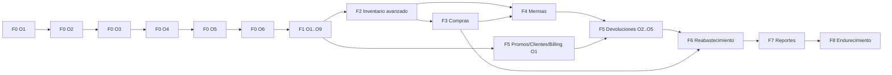

# Plan del proyecto — POS Minimarket

> Parte del diseño de POS Minimarket. Las secciones conservan su letra (A–J) para que las referencias cruzadas funcionen entre documentos: A, C, E, H, I en [PLAN.md](PLAN.md) · B en [MODELO_DATOS.md](MODELO_DATOS.md) · D en [ROLES_PERMISOS.md](ROLES_PERMISOS.md) · F en [API.md](API.md) · G en [HISTORIAS_USUARIO.md](HISTORIAS_USUARIO.md).

> **Estado:** plan pendiente de aprobación. No se ha implementado nada.

## A. Arquitectura general

### A.1 Objetivo y alcance

**Objetivo:** construir un POS e inventario para minimarkets chilenos, de una sola empresa con N locales. El nivel debe ser el de un producto comercial: monolito modular Spring Boot, SPA Angular y PostgreSQL.

**Entra:** los 9 módulos funcionales del enunciado; boleta electrónica, pagos con tarjeta y almacenamiento S3 **simulados detrás de puertos**; correo real en local con Mailpit; OpenAPI; datos semilla de demo; Docker Compose; CI de build y pruebas.

**Queda fuera (MVP):**
- Integración real con SII, transbank u otro adquirente.
- Operación offline del POS. Se exige conectividad con el backend; solo se guarda localmente el carrito en curso.
- SaaS multi-tenant.
- Contabilidad y facturación de compras.
- Devoluciones a proveedor.
- App móvil nativa.
- Impresión ESC/POS directa. Se imprime desde el navegador.
- Estacionalidad y tendencia en el reabastecimiento (queda como mejora).
- Precios distintos por local (ver E).
- Alta disponibilidad con varias instancias.

### A.2 Decisiones de arquitectura

| ADR | Decisión | Alternativas descartadas | Justificación |
|---|---|---|---|
| ADR-01 | **Spring Boot 4.0.x** (Spring Framework 7, Hibernate 7, Jackson 3) sobre **Java 21**. **DECISIÓN ABIERTA**: el usuario pidió Boot 3. | Boot 3.5.x; Java 25 | Si se confirma que el soporte OSS de 3.5 terminó a mediados de 2026, empezar un proyecto nuevo en 3.x nace con deuda. Impacto: Jackson 3 cambia de paquete (`tools.jackson`); hay que usar springdoc 3.x, Spring Modulith 2.x y Testcontainers 2.x. La tarea técnica 1 debe verificar fechas y compatibilidad. Si algo falla, se usa 3.5.x sin cambiar el diseño. Java 25 LTS es opcional; Java 21 cumple. |
| ADR-02 | **Monolito modular**: un solo deployable, un paquete por dominio y fronteras verificadas con **Spring Modulith** (`ApplicationModules.verify()` en un test). | Microservicios; solo ArchUnit | La venta exige atomicidad entre stock, venta, pagos y fiado en **una** transacción. Los microservicios obligarían a usar sagas sin beneficio a esta escala. Modulith verifica dependencias, documenta los módulos y ofrece eventos con registro persistente. |
| ADR-03 | La comunicación entre módulos usa **llamadas síncronas a la API pública** cuando hay atomicidad y **eventos de dominio** (`@TransactionalEventListener` / `@ApplicationModuleListener` después del commit) para los efectos secundarios: boleta, correo y agregados. | Todo por eventos; todo síncrono | El stock debe quedar en la misma transacción que la venta. La boleta y el correo no deben bloquear la venta ni revertirla. |
| ADR-04 | Capas por módulo: `web` → `application` → `domain` ← `infrastructure`. El paquete raíz del módulo es su API pública. | Arquitectura hexagonal completa por módulo | Separa responsabilidades sin multiplicar interfaces. Solo se definen puertos donde hay integración externa o una frontera entre módulos. |
| ADR-05 | **MapStruct** para entidad↔DTO. Los DTO son `record`. | ModelMapper (reflexión, errores en runtime); mapeo manual | MapStruct se resuelve en compilación, es tipado y rápido. |
| ADR-06 | **RFC 9457 Problem Details** (`ProblemDetail` de Spring) con extensiones `code`, `traceId` y `errors[]`. | Formato propio | Es un estándar, Spring lo soporta de forma nativa y su contrato es estable para el frontend. |
| ADR-07 | **PDF**: plantillas Thymeleaf convertidas a HTML y luego a PDF con **OpenHTMLtoPDF** (fork `io.github.openhtmltopdf`). | iText (licencia AGPL); JasperReports (pesado, diseñador aparte); OpenPDF a mano | Las plantillas HTML se mantienen con facilidad (órdenes de compra, cierre de caja, reportes). El ticket de 80 mm **no** usa PDF: se imprime desde el navegador. |
| ADR-08 | **Excel**: Apache POI. Para exportar se usa `SXSSFWorkbook` en streaming y para importar `XSSF`. **CSV**: Apache Commons CSV. | FastExcel; EasyExcel | POI es el estándar y su streaming evita problemas de memoria con reportes grandes. |
| ADR-09 | Archivos detrás del puerto `FileStorage`. Adaptador MVP: **filesystem sobre volumen Docker**. Se deja preparado un adaptador S3 compatible. | MinIO en el compose; BYTEA en PostgreSQL | Menos servicios en local. MinIO cambió su licencia y recortó su edición comunitaria. BYTEA infla los respaldos. La metadata va en `stored_files`. |
| ADR-10 | **Correo**: Spring Mail detrás de `EmailGateway`, con tabla outbox (`outbound_emails`) y un job de envío. En local se usa **Mailpit**. | Envío síncrono | Un SMTP caído no debe afectar la venta, y la outbox permite reintentos. |
| ADR-11 | **Reportes**: consultas SQL con proyecciones (`JdbcClient` / consultas nativas de solo lectura) sobre las tablas transaccionales, más una **tabla de agregados diarios** (`daily_product_sales`) que llena un job. | Vistas materializadas; data warehouse | Las vistas materializadas bloquean al refrescarse y cuestan más de probar. El agregado diario también alimenta el reabastecimiento. Las vistas materializadas quedan como optimización futura. |
| ADR-12 | Una empresa con N locales, sin multi-tenant. El **local activo** viaja en el header `X-Store-Id` (y la terminal en `X-Terminal-Id`). Un filtro (`StoreContextFilter`, de shared) lo valida a través del puerto `StoreAccessValidator` (lo implementa security) contra los locales del usuario y lo deja en `StoreContext`, con alcance de request. | `store_id` dentro del JWT; subdominios; tenant por esquema | Un usuario puede trabajar en varios locales sin pedir un token nuevo. La validación es del lado del servidor y cada request se revalida. |
| ADR-13 | **Stock nunca negativo** con tres medidas: (1) `UPDATE stock SET quantity = quantity - :q WHERE store_id=:s AND product_id=:p AND quantity >= :q RETURNING quantity`; si actualiza 0 filas se lanza `STOCK_INSUFFICIENT` y la transacción se revierte; (2) `CHECK (quantity >= 0)` en la BD como red de seguridad; (3) las líneas se consolidan por producto y se procesan **ordenadas por `product_id` ascendente**, y los lotes por `(expiry_date NULLS LAST, id)` con `FOR UPDATE`, para evitar deadlocks. Aislamiento READ COMMITTED. | Optimista con `@Version` (reintentos en horas punta); bloqueo pesimista sobre la entidad | El UPDATE condicional es atómico, no necesita reintentos y bloquea solo la fila afectada. |
| ADR-14 | **Idempotencia**: header `Idempotency-Key` (UUID) obligatorio en los POST que crean dinero o stock (venta, devolución, movimiento de caja, abono, autorización de tarjeta); su ausencia es 400 `VALIDATION_ERROR`. Se registra en `idempotency_keys` con el hash del request, y `sales.idempotency_key` es UNIQUE como última barrera. | Deduplicar solo por contenido | Los reintentos de red o el doble Enter en caja no deben duplicar ventas. |
| ADR-15 | **Costo promedio ponderado global por producto**, en `products.avg_cost` (ver fórmulas en A.5). | Costo por producto-local | Se trata de una sola empresa con contabilidad única. Las transferencias no alteran el costo y el cálculo es más simple. |
| ADR-16 | **Lotes opcionales**: `stock` es la fuente de verdad de la disponibilidad. Si `lot_controlled=true`, entonces `Σ lots.quantity = stock.quantity`, en la misma transacción. La venta descuenta lotes por FEFO automáticamente. | Stock solo por lote | Los productos sin lote no pagan el costo de gestionar lotes. |
| ADR-17 | **Packs**: un producto `sale_type=PACK` tiene una fila en `product_packs` con producto base y factor. El pack **no tiene stock**: vender un pack descuenta `cantidad × factor` del base. | Pack con stock propio | Evita inventarios duplicados. Los reportes de unidades y el reabastecimiento se consolidan en el producto base (vía `sale_lines.stock_quantity`). |
| ADR-18 | **Auditoría inmutable**: la tabla `audit_log` es append-only. Sobre esa tabla el usuario de BD de la app solo tiene `INSERT, SELECT` (en el resto del esquema tiene DML completo, B "Notación"), un trigger rechaza UPDATE y DELETE, y hay un **hash encadenado** SHA-256 (`hash = sha256(prev_hash ∥ payload canónico)`) con un endpoint de verificación. | Solo convención | Ofrece defensa en profundidad y evidencia de manipulación. |
| ADR-19 | **Override de supervisor** transversal: `POST /auth/overrides` valida al supervisor (PIN o clave), su permiso, su límite y que sea distinto del solicitante. Emite un token de un solo uso (5 min) ligado a la acción, el hash del contexto, el local, la terminal y el solicitante. El endpoint de negocio lo consume con `X-Override-Token` y el consumo valida además que el solicitante sea el usuario actual y que coincidan el local y la terminal (si la autorización la tiene). Un endpoint con override responde 422 `OVERRIDE_REQUIRED` (no 403) si falta permiso o límite (D.4). | Pedir la clave dentro de cada endpoint | Un solo mecanismo reutilizable, auditable y probado. |
| ADR-20 | **Autenticación**: JWT de acceso HS256 de 15 min (secreto de ≥256 bits por variable de entorno) que se guarda en memoria en el frontend. **Refresh token opaco** en cookie `HttpOnly; Secure; SameSite=Strict; Path=/api/v1/auth`, rotado en cada uso, guardado como SHA-256, con **familia** para detectar reutilización (si se reutiliza, se revoca la familia). BCrypt de costo 12 para contraseña y PIN. | RS256 (innecesario en un monolito); access token en localStorage (riesgo de XSS) | Es el estándar seguro y simple. |
| ADR-21 | Rate limiting con **Bucket4j** en memoria en `/auth/login`, `/auth/overrides` y `/auth/pin-login`: 10/min por IP y 5/min por usuario objetivo. Bloqueo de cuenta tras 5 fallos durante 15 min (configurable); los fallos de PASSWORD en un override también incrementan `failed_attempts`. El PIN se bloquea tras `security.pin.max_attempts` y se desbloquea solo pasados `security.pin.lockout_minutes` (15 por defecto). | Gateway externo | Hay una sola instancia. Si se escala, se pasa a Redis. |
| ADR-22 | Los enums se guardan como `varchar(30)` + `CHECK` y en JPA como `@Enumerated(STRING)`. | Tipos ENUM de PostgreSQL | Migrar es más fácil (agregar un valor es un cambio del CHECK) y Hibernate no necesita tipos custom. |
| ADR-23 | **Flyway** con versiones numéricas `V{yyyyMMdd}{tarea:4}{orden:1}__{modulo}_{desc}.sql`. Esquema de versión: `V20261201` + número de tarea con 4 dígitos + 1 dígito de orden de archivo dentro de la tarea (T7 → `V2026120100071__...`; su segundo archivo, `V2026120100072__...`). Los datos semilla de demo van en `db/demo`, con versión `V20990101` + tarea (4 dígitos) + orden (1 dígito) (T43 → `V2099010100431__...`), y se activan solo con el perfil `demo`. En dev se activa `out-of-order` (H.1). | `V1, V2…` secuenciales | Varios implementadores en paralelo no colisionan. |
| ADR-24 | **Frontend**: Angular, última estable al iniciar (verificar con `npm view @angular/core version`). Componentes **standalone**, **zoneless**, **signals**, rutas lazy por feature y Reactive Forms tipados (no los signal forms experimentales). | NgModules; Zone.js | Es el estándar actual del framework. |
| ADR-25 | **Estado**: servicios con signals por feature (`*Store` con `signal` y `computed`). El carrito del POS se persiste en `localStorage` para recuperarse tras un crash. | NgRx Store/SignalStore | No hay estado global complejo y así se reduce el boilerplate. |
| ADR-26 | **UI**: Angular Material 3 + CDK. | PrimeNG; Tailwind solo | Es la librería oficial, accesible, con tabla y paginador consistentes y teclado vía CDK. |
| ADR-27 | Cliente HTTP **generado desde OpenAPI** con `ng-openapi-gen` en `src/app/api` (no se edita a mano). | Servicios a mano | Mantiene el contrato sincronizado entre backend y frontend. |
| ADR-28 | **Teclado y lector en el POS**: `PosKeyboardService` con un keymap configurable. El lector funciona como teclado (wedge): un buffer detecta ráfagas de menos de 30 ms entre caracteres terminadas en Enter, y el input de escaneo mantiene el foco. | Lectores con driver | No necesita hardware especial. |
| ADR-29 | **Ticket de 80 mm**: componente de impresión con `@page { size: 80mm auto; margin: 0 }`, impreso en un iframe oculto con `window.print()`. Para impresión silenciosa se recomienda Chrome con `--kiosk-printing`. | QZ Tray/ESC-POS (queda futuro, detrás de `TicketPrinter`) | Funciona sin instalar nada. |
| ADR-30 | **Contexto Chile**: CLP sin decimales; precio de venta **con impuestos incluidos**; impuestos en la tabla `taxes` (IVA 19 %, ILA, IABA cargados por semilla). Redondeo legal del efectivo al múltiplo de $10 sobre la porción en efectivo. RUT validado con módulo 11 en back y front. Códigos de balanza configurables. | Impuestos en el código | Lo exige el enunciado. |
| ADR-31 | Jobs con `@Scheduled` en una sola instancia: agregados diarios a las 02:00 en la zona de la empresa, outbox de correo cada 1 min, expiración de suspendidas y de claves de idempotencia. | Quartz; ShedLock | No hay varias instancias. Se agrega ShedLock si se escala. |
| ADR-32 | **Infraestructura local**: Docker Compose con `postgres:17`, `mailpit`, `api` y `web` (nginx). En desarrollo se recomienda correr la api y el web fuera de Docker. | | Es simple y reproducible. |

### A.3 Estructura del repositorio

```
pos-minimarket/
├─ backend/                         # Maven, Spring Boot
│  ├─ pom.xml
│  └─ src/main/java/cl/minimarket/pos/
│     ├─ PosApplication.java
│     ├─ shared/                    # kernel abierto (@ApplicationModule(type=OPEN))
│     │  ├─ money/ (Money, Quantity, Rounding, CashRounding)
│     │  ├─ rut/ (Rut, RutValidator)   ├─ error/ (ErrorCode, BusinessException, GlobalExceptionHandler)
│     │  ├─ web/ (PageResponse, PageQuery, SortParser) ├─ context/ (StoreContext, StoreContextFilter)
│     │  ├─ idempotency/            ├─ sequence/ (SequenceService)  ├─ time/ (BusinessClock)
│     │  ├─ persistence/ (AuditableEntity, jobs de purga)  ├─ export/ (PdfRenderer, XlsxWriter, CsvWriter, CsvXlsxReader)
│     │  └─ security/ (Permissions)
│     ├─ audit/  security/  organization/  files/  notification/
│     ├─ catalog/  dataexchange/  promotions/  customers/  inventory/  shrinkage/
│     ├─ purchasing/  replenishment/  sales/  billing/  cash/  reporting/
│     │   # cada módulo:
│     │   ├─ <Modulo>Api.java, *Event.java, DTO record públicos   ← API pública (paquete raíz)
│     │   ├─ web/            controllers + Request/Response DTO
│     │   ├─ application/    servicios @Transactional, casos de uso
│     │   ├─ domain/         entidades JPA, value objects, lógica pura
│     │   └─ infrastructure/ repositorios, adaptadores, queries SQL
│  └─ src/main/resources/
│     ├─ application.yml, application-{dev,demo,test,prod}.yml
│     ├─ db/migration/  db/demo/  templates/pdf/  templates/mail/
│  └─ src/test/java/...  (unit, *IT con Testcontainers, ModularityTest)
├─ frontend/
│  └─ src/app/
│     ├─ core/      auth/, interceptors/ (auth, store-context, idempotency, error), guards/, layout/, store-context/
│     ├─ shared/    ui/ (tabla paginada, diálogos, autorización supervisor), pipes/ (clp, rut, qty), validators/ (rut)
│     ├─ api/       (generado, no editar)
│     └─ features/  auth, dashboard, pos, cash, catalog, promotions, customers, purchasing,
│                   replenishment, inventory, shrinkage, reports, settings, security
├─ docker/  postgres/init/ (roles BD, extensiones), nginx/
├─ docker-compose.yml   .env.example   .github/workflows/ci.yml
└─ docs/   PLAN.md, MODELO_DATOS.md, ROLES_PERMISOS.md, API.md, HISTORIAS_USUARIO.md, adr/
```

**Reglas de dependencia:**
- Un módulo solo importa el **paquete raíz** de otro módulo, más `shared`.
- Están prohibidos los ciclos; `ModularityTest` falla si aparecen.
- No hay FK lógicas desde entidades JPA entre módulos: se referencian por `Long id`. Las FK sí existen en la BD.
- `reporting` puede **leer** cualquier tabla por SQL y solo escribe sus agregados. Es la única excepción.

**Convenciones:**
- Tablas: snake_case, plural, en inglés (`sale_lines`). Columnas: snake_case; FK `<entidad>_id`; booleanos `is_`/`has_` solo cuando sea ambiguo.
- Nombres de restricciones: `pk_`, `fk_<tabla>_<ref>`, `uq_<tabla>_<cols>`, `ck_<tabla>_<regla>`, `ix_<tabla>_<cols>`.
- Paquetes: `cl.minimarket.pos.<modulo>.<capa>`. Clases: entidad `Product`, `ProductRepository`, `ProductService`, `ProductMapper`, `ProductController`.
- DTOs: `CreateProductRequest`, `UpdateProductRequest`, `ProductResponse`, `ProductSummaryResponse`, `ProductFilter`. Eventos `SaleCompletedEvent`; APIs `XxxApi`; puertos externos con nombre de rol (`PaymentGateway`).
- REST: `/api/v1/<recurso-kebab-plural>`; acciones como subrecurso (`/sales/{id}/void`).
- Flyway: según ADR-23.
- Frontend: kebab-case según el estilo del CLI de la versión usada; rutas en español (`/caja`, `/inventario/tomas`).
- Código e identificadores en inglés; UI, comentarios y docs en español.

### A.4 Módulos backend

| Módulo | Responsabilidad | Depende de | API pública |
|---|---|---|---|
| shared | Dinero, RUT, errores, paginación, StoreContext, idempotencia, secuencias, reloj | nada | `Money`, `Quantity`, `Rut`, `StoreContext`, `SequenceService.next(SequenceType, Long storeId): String`, `IdempotencyService`; puerto `StoreAccessValidator` (en el paquete raíz de `shared`; lo define shared y lo implementa security): `void requireAccess(Long userId, Long storeId, Long terminalId)` lanza `STORE_ACCESS_DENIED`; `StoreContextFilter` lo invoca para validar el local y la terminal de cada request |
| audit | Bitácora inmutable | shared | `AuditService.record(AuditEvent e)` (en la tx del llamador); `AuditEvent(String action, String entityType, String entityId, Object oldValue, Object newValue, String reason, Long authorizationId)` |
| security | Login, tokens, usuarios, roles, permisos, límites por rol, overrides | shared, audit, organization | `CurrentUser current()`, `boolean hasPermission(String code, Long storeId)`, `RoleLimitApi.limitFor(Long userId, RoleLimitCode c): RoleLimit` (el más permisivo entre los roles del usuario; `RoleLimit` es un tipo explícito `LIMITED(BigDecimal x)` \| `UNLIMITED`; fail-closed: sin fila = `LIMITED(0)`, D.3), `SupervisorOverrideApi.consume(String token, OverrideAction a, String contextHash, Long requesterId): AuthorizationRef` (valida además local y terminal desde `StoreContext`); implementa `StoreAccessValidator` (definido por shared) apoyándose en `StoreApi` y `TerminalApi` |
| organization | Empresa, locales, terminales, settings | shared, audit | `StoreApi.get(Long id)`, `StoreApi.activeStoreIds(): List<Long>`, `TerminalApi.requireActive(Long terminalId, Long storeId)`, `SettingsApi.get(String key, Long storeId, Class<T>)` (el valor del local tiene prioridad sobre el global); evento `StoreCreatedEvent` (lo escucha inventory). Puertos en su paquete raíz, con implementación por defecto que permite todo (T18) y que cash reemplaza (T29): `StoreUsageGuard` y `TerminalUsageGuard`, ambos con `void assertCanDeactivate(Long id)`, que lanza `ENTITY_IN_USE` (p. ej. un turno de caja abierto) y se invoca antes de desactivar un local o una terminal |
| files | Metadata de archivos y almacenamiento | shared | `FileStorage` (ver abajo), `FileApi.register(...)`, `FileApi.open(Long fileId)` |
| notification | Outbox de correo | shared, files | `EmailOutboxApi.enqueue(EmailMessage m)`; puerto `EmailGateway` |
| catalog | Productos, códigos, impuestos, packs, precios, balanza | shared, audit, files, security, organization | `ProductCatalogApi`: `ProductSnapshot getForSale(Long id)`, `Optional<ScanResult> resolveCode(String code)` (decodifica la balanza y devuelve producto, cantidad o precio embebido), `List<ProductSnapshot> search(String q, int limit)` (nombre por trigram, SKU, atajo o prefijo de código; solo activos), `List<ProductSnapshot> findByIds(Collection<Long>)`, `void applyAverageCost(Long productId, BigDecimal newAvg, PriceChangeType t, String sourceRef)`, `List<TaxRate> taxesFor(Long productId)`, `Optional<PackInfo> packOf(Long productId)`, `List<Long> nonPackProductIds()` (productos que no son PACK, para crear filas de stock), más lo que `dataexchange` necesita (`createFromImport`, `findForExport`). Puerto `LotControlGuard` (en el paquete raíz; **lo define catalog y lo implementa inventory**, así catalog no depende de inventory): `void apply(Long productId, boolean lotControlled)` valida y aplica el cambio de `lot_controlled` en la transacción del llamador (RN-04) y lanza `ENTITY_IN_USE` si no procede. Los endpoints `/pos/products/*` no son de catalog (están en sales) |
| dataexchange | Importación y exportación masiva del catálogo (`import_jobs`, plantillas CSV/XLSX, dry-run y confirmación) | shared, audit, files, security, catalog, inventory, purchasing | Sin API pública: solo endpoints (`/catalog/imports*`, `/products/export`). Usa `ProductCatalogApi`, `StockApi` (INITIAL_STOCK) y `ProductSupplierApi.upsert` (PRODUCT_SUPPLIERS) |
| promotions | Promociones y motor de evaluación | shared, catalog, audit | `PromotionEngine.evaluate(PricingContext ctx): PromotionResult`. Mientras no exista la fase 5, `PromotionEngine` tiene una implementación no-op (`NoopPromotionEngine`) |
| customers | Clientes y cuenta corriente | shared, audit, security, cash | `CustomerCreditApi.charge(Long customerId, BigDecimal amount, Long saleId, Long storeId)`, `reverse(Long customerId, BigDecimal amount, Long saleReturnId)`; implementa `CashFlowContributor` (abonos) |
| inventory | Stock, lotes, kardex, ajustes, tomas, transferencias, vencimientos | shared, audit, catalog, security, organization | `StockApi.apply(StockCommand cmd): List<StockMovementResult>` (consolida, ordena, aplica FEFO y escribe el kardex). Interfaz `TransferDifferenceHandler` (en el paquete raíz; la define inventory y la implementa shrinkage): se invoca al recibir una transferencia con diferencia. Implementa `LotControlGuard` (definido por catalog) y escucha `ProductCreatedEvent` y `StoreCreatedEvent`. Desde la fase 1, `StockCommand` incluye por línea `lotId?`, `lotNumber?` y `expiryDate?`, de modo que su firma no cambie en la fase 2; `StockMovementResult` incluye `allocations[{lotId, quantity}]`; `BigDecimal onHand(Long storeId, Long productId)`; `Map<Long,BigDecimal> inTransitInbound(Long storeId)`; `BigDecimal companyQuantity(Long productId)` (todos los locales + tránsito) |
| shrinkage | Mermas | shared, audit, inventory, catalog, files, security | Implementa `TransferDifferenceHandler` (definida por inventory: crea la merma sistémica TRANSFER_DIFFERENCE, B.6); `ShrinkageApi.createFromSaleReturn(...)` (merma sistémica DAMAGED de una devolución sin reingreso; la usa sales) |
| purchasing | Proveedores, producto-proveedor, órdenes, recepciones | shared, audit, catalog, inventory, files, security, notification | `PurchaseOrderApi.createDrafts(List<DraftOrderCommand>): List<Long>`, `OpenOrdersQuery.pendingQuantities(Long storeId): Map<Long,BigDecimal>`, `ProductSupplierQuery.candidates(Long productId)`, `ProductSupplierApi.upsert(ProductSupplierCommand)` |
| replenishment | Parámetros, corridas y líneas de sugerencia | shared, catalog, inventory, purchasing, reporting, organization | `ReplenishmentApi.run(Long storeId, LocalDate asOf)` |
| sales | Venta POS (incluye `/pos/products/search` y `/pos/products/resolve`, paquete `sales/pos`), pagos, suspendidas, anulaciones y devoluciones | shared, audit, catalog, promotions, customers, inventory, shrinkage, notification, cash, security, organization | eventos `SaleCompletedEvent`, `SaleReturnedEvent`; `SaleLookupApi.cashierOf(Long saleId)`; implementa `CashFlowContributor`; puerto `PaymentGateway`. **No depende de billing**: el documento tributario se consulta con los endpoints de billing |
| billing | Documentos tributarios simulados | shared, organization, sales (eventos y `SaleLookupApi`) | escucha eventos; endpoints `/tax-documents*`, `GET /sales/{id}/tax-document` y `GET /sale-returns/{id}/tax-document`; puerto `ElectronicInvoiceProvider` |
| cash | Turnos, movimientos, arqueo | shared, audit, security, organization | `CashSessionApi.requireOpen(Long terminalId): CashSessionRef`; define `CashFlowContributor` (inversión de dependencia: sales y customers lo implementan, lo que evita el ciclo cash↔sales); implementa `StoreUsageGuard` y `TerminalUsageGuard` (definidos por organization): impide desactivar un local o una terminal con un turno abierto |
| reporting | Dashboard, reportes, exportaciones, agregados diarios | shared, files (solo lectura SQL de todo) | `SalesHistoryApi.dailyDemand(Long storeId, Collection<Long> productIds, LocalDate from, LocalDate to): List<DailyDemand>` |

**Puertos de integración (firmas):**
```java
interface PaymentGateway {            // adaptador MVP: SimulatedPaymentGateway
  PaymentResult authorize(PaymentRequest r); // r: terminalId, method(DEBIT|CREDIT), amount, idempotencyKey, reference
  RefundResult refund(RefundRequest r);      // r: gatewayReference, amount, idempotencyKey
  String providerCode();
}
record PaymentResult(PaymentResultStatus status /*APPROVED|DECLINED|ERROR*/, String gatewayReference,
                     String authorizationCode, String cardBrand, String last4, String errorCode, String message) {}
// Simulado: aprueba siempre, salvo montos terminados en 13 (DECLINED) y 99 (ERROR), para demos y tests.

interface ElectronicInvoiceProvider { // adaptador MVP: SimulatedInvoiceProvider (genera trackId y "timbre" ficticio)
  IssueResult issue(TaxDocumentRequest r);       // tipo(39/41/61), folio, emisor, receptor?, líneas, totales, docReferencia?
  DocumentStatusResult status(String providerTrackId);
  String providerCode();
}
interface FileStorage {               // adaptador MVP: LocalFileSystemStorage(root=/data/files)
  StoredObject store(InputStream in, String contentType, long size, FileCategory c); // valida magic bytes y tamaño; clave aleatoria UUID
  InputStream open(String storageKey);
  void delete(String storageKey);
}
interface EmailGateway { void send(EmailMessage m); } // adaptador SMTP (Mailpit en local)
interface CashFlowContributor { Map<PaymentMethod, BigDecimal> netAmountsBySession(Long cashSessionId); }
```

### A.5 Convenciones transversales

**Errores (RFC 9457).**
- Formato: `{type, title, status, detail, instance, code, traceId, errors:[{field, code, message}]}`.
- `type` = `https://pos-minimarket/errors/<code-kebab>`; `code` es un valor estable de `ErrorCode`. Ejemplos: `VALIDATION_ERROR`, `NOT_FOUND`, `STOCK_INSUFFICIENT`, `CASH_SESSION_NOT_OPEN`, `DISCOUNT_LIMIT_EXCEEDED`, `OVERRIDE_REQUIRED`, `OVERRIDE_INVALID`, `IDEMPOTENCY_CONFLICT`, `CREDIT_LIMIT_EXCEEDED`, `STORE_ACCESS_DENIED`, `ACCOUNT_LOCKED`, `CONCURRENT_MODIFICATION`, `SEGREGATION_OF_DUTIES`. El catálogo completo de códigos, incluidos los añadidos después de esta lista, está en F.1 de [API.md](API.md), que es la fuente de verdad.
- Mapa de estados HTTP (resumen; la tabla código → HTTP completa está en F.1): 400 validación (incluye `Idempotency-Key` ausente); 401 sin autenticar o credencial/token inválido; 403 (permiso o local); 404; 409 conflicto (versión, idempotencia, estado, duplicado, en uso); 422 regla de negocio (incluye `OVERRIDE_REQUIRED`); 429 límite de tasa.
- Las respuestas nunca incluyen stack traces.

**Paginación, filtros y orden.**
- Query: `page` (desde 0), `size` (por defecto 20, máximo 200), `sort=campo,asc|desc`, que se puede repetir y se valida contra una lista blanca por endpoint.
- Filtros como query params tipados (`ProductFilter`).
- Respuesta `PageResponse<T>{content, page, size, totalElements, totalPages, sort}`.
- La búsqueda de texto usa `q` con `ILIKE` sobre `f_unaccent(lower(name))` (índice trigram).

**Dinero y redondeo** (todo `BigDecimal`; se prohíben `double` y `float`, lo que verifica una regla ArchUnit o Checkstyle):

| Dato | Tipo BD | Escala | Redondeo |
|---|---|---|---|
| Montos CLP de venta, caja y fiado (precios, totales, impuestos, pagos) | numeric(14,0) / precios numeric(12,0) | 0 | HALF_UP |
| Costo unitario (avg, último, por línea) | numeric(14,4) | 4 | HALF_UP |
| Totales de costo (línea, valorización, merma) | numeric(16,2) | 2 | HALF_UP |
| Cantidades | numeric(14,3) | 3 (unidades enteras validadas en servicio) | HALF_UP |
| Tasas de impuesto y porcentajes | numeric(7,4), en % (19.0000) | 4 | n/a |
| Intermedios de cálculo | `MathContext.DECIMAL64` | n/a | se redondea solo al persistir o presentar |

**Fórmulas de dinero:**
- **Neto e impuestos por línea:** `R = Σ rate_i/100` de los impuestos del producto. `net = round(line_total_gross / (1+R), 0)`, `tax_total = line_total_gross − net`. Cada impuesto `tax_i = round(net × rate_i/100, 0)`; el último impuesto, ordenado por id, recibe la diferencia para que `Σ tax_i = tax_total`. Los totales del documento son sumas de las líneas.
- **Productos exentos (`vat_exempt`):** sin otros impuestos, `line_exempt = line_total_gross` y `net = tax = 0`. Con un impuesto adicional (ILA, IABA), se desglosa solo ese impuesto con la fórmula anterior (`R` sin el IVA) y `line_exempt = 0`.
- **Pesables:** `line_subtotal_gross = round(qty_kg × price_per_kg, 0)`.
- **Descuento al total:** se prorratea entre las líneas proporcionalmente a `line_subtotal_gross − descuentos de línea` (mayor resto) antes de calcular el neto.
- **Redondeo del efectivo (Ley 20.956):** solo aplica a la porción pagada en efectivo. Si `x` es el monto en efectivo adeudado, `d = x mod 10`; si `d ≤ 5` se resta `d`, si no se suma `10−d`. `rounding_adjustment ∈ [−5, +4]`. Si no hay efectivo, o si `pos.cash_rounding.enabled = false`, el ajuste es 0.
- **Pagos de la venta:** `sale_payments.amount` es lo aplicado a la venta (en efectivo, entregado − vuelto, ya redondeado) y `tendered_amount` es lo entregado (solo efectivo). `Σ amount = total_payable`; `sales.paid_total = Σ COALESCE(tendered_amount, amount)` y `paid_total − change_total = total_payable` (B.9, RN-07).
- **Costo promedio ponderado:** `Q = companyQuantity(product)` antes de la entrada (stock de todos los locales + tránsito). `q_in = qty_received − qty_rejected` de la línea de recepción (lo rechazado no entra al stock ni al costo). Si `Q ≤ 0`, `avg' = c_in`. Si no, `avg' = round((Q×avg + q_in×c_in)/(Q+q_in), 4)`. Solo lo modifican la **recepción de compra** y la **carga inicial**. Ventas, mermas, ajustes de salida y transferencias salen al `avg` vigente sin modificarlo. Devoluciones, anulaciones y ajustes de entrada reingresan al `avg` vigente, también sin modificarlo. El costo de compra es **neto de IVA**. En la orden de compra, `tax_total = Σ round(line_net_total × tasa IVA vigente / 100, 0)` (B.4).

**Fechas.**
- Todo se guarda en `timestamptz` (UTC) y la JVM corre en `TZ=UTC`.
- La zona de negocio es `company.timezone` (`America/Santiago`). `business_date` (tipo date) se calcula con esa zona en ventas, turnos y agregados.
- La API usa ISO-8601 con offset. `BusinessClock` es inyectable para los tests.

**Idempotencia:**
1. Se hace `INSERT` en `idempotency_keys` en estado `IN_PROGRESS`, dentro de su propia transacción.
2. Si la clave ya existe: con el mismo hash y `COMPLETED` se devuelve la respuesta guardada; con `IN_PROGRESS` se devuelve 409 `IDEMPOTENCY_IN_PROGRESS`; con otro hash, 409 `IDEMPOTENCY_CONFLICT`. Si el header falta, 400 `VALIDATION_ERROR`.
3. Al terminar se guarda la respuesta. TTL de 24 h.

**Transacciones:**
- `@Transactional` solo en `application` y nunca en controllers. Los casos de uso de escritura usan una transacción READ COMMITTED.
- Las llamadas externas (gateway, proveedor DTE, SMTP) **nunca** ocurren dentro de una transacción que bloquee stock. La tarjeta se autoriza en un paso previo y la boleta y el correo van después del commit.

**Logging:**
- SLF4J. JSON (logstash-encoder) en `prod`; texto en `dev`.
- MDC: `traceId`, `userId`, `storeId`, `terminalId`.
- Nunca se registran contraseñas, PIN, tokens ni datos completos de tarjeta.
- Actuator expone solo `health` e `info`.


## C. Algoritmo de sugerencia de reabastecimiento

### C.1 Variables
- `W`: ventana en días.
- `q_d`: venta neta del día en unidad base, desde `daily_product_sales` (packs ya consolidados; pesables en kg).
- `V`: conjunto de días válidos, sin quiebre. `N = |V|`.
- `Cd`: días censurados, es decir, los días de la ventana con quiebre (`had_stockout_d = true`) desde la fecha de creación del producto. Los días anteriores a la creación del producto no son válidos ni censurados.
- `D`: demanda diaria promedio.
- `σ`: desviación estándar muestral.
- `L`: lead time en días.
- `R`: período de revisión.
- `z`: factor de nivel de servicio.
- `Smin`: días mínimos de stock de seguridad.
- `SS`: stock de seguridad.
- `ROP`: punto de reorden.
- `T`: nivel objetivo.
- `OH`: stock en mano.
- `IT`: en tránsito (OC SENT o PARTIALLY_RECEIVED: `qty_ordered − qty_received`; transferencias SENT hacia el local).
- `IP = OH + IT`.
- `U`: unidades base por unidad de compra.
- `MOQ`: mínimo en unidades de compra.
- `Upper`: tope superior.

Todos los intermedios se redondean a 4 decimales HALF_UP y cada fórmula usa los valores ya redondeados. Las cantidades finales van a 3 decimales.

### C.2 Parámetros y nivel

La resolución va del más específico al más general: producto, luego categoría (subcategoría y después categoría padre), luego local, luego global.

| Parámetro | Default | Niveles |
|---|---|---|
| `window_days` W | 30 | G, S, C, P |
| `min_history_days` | 7 | G, C, P |
| `service_level_z` | 1.65 | G, C, P |
| `safety_min_days` Smin | 1 | G, S, C, P |
| `review_period_days` R | 7 (si el proveedor tiene `delivery_weekdays` con n días, `R = ceil(7/n)`) | G, S, P |
| `outlier_k` | 3 | G |
| `shelf_life_factor` f | 0.7 | G, C, P |
| `enabled` | true | G, S, C, P |

`L = product_suppliers.lead_time_days_override ?? suppliers.lead_time_days`. `min_qty` y `max_qty` vienen de `stock`.

### C.3 Fórmulas
1. **Demanda censurada:** `V = {d ∈ [asOf−W, asOf−1] : had_stockout_d = false ∧ d ≥ fecha de creación del producto}`.
2. **Outliers** (mediana/MAD): `med = mediana(q_V)`, `MAD = mediana(|q_d − med|)`. Si `MAD > 0`: `cap = med + k·1.4826·MAD` y `q'_d = min(q_d, cap)`. Si `MAD = 0` no se recorta.
3. `D = Σ q'_d / N`. `σ = sqrt(Σ (q'_d − D)² / (N−1))`; si `N < 2`, σ = 0.
4. `SS = max(z·σ·√L, Smin·D)`.
5. `ROP = max(D·L + SS, min_qty ?? 0)`.
6. **Disparo:** se sugiere si `IP ≤ ROP`.
7. `T = max(D·(L+R) + SS, min_qty ?? 0)`.
8. **Tope:** `Upper = min(max_qty ?? ∞, shelfCap ?? ∞)`, con `shelfCap = D·shelf_life_days·f` cuando el producto tiene `shelf_life_days`. `T = min(T, Upper)`.
9. `Need = T − IP`. Si `Need ≤ 0` el resultado es NO_ACTION.
10. **Redondeo:** `n = max(ceil(Need/U), MOQ)`. Si `IP + n·U > Upper` y `n > MOQ`, entonces `n = max(MOQ, floor((Upper − IP)/U))` con flag CAPPED_BY_UPPER. Si el resultado es 0, `n = max(1, MOQ)`. Si n se elevó por MOQ se marca MOQ_APPLIED.
11. `suggested_qty = n·U`.
12. **Quiebre:** `days_of_cover = OH / D` y `estimated_stockout_date = asOf + floor(days_of_cover)`; si `D = 0`, ambos son null.

### C.4 Elección de proveedor
Se consideran los `product_suppliers` activos con proveedor activo. Se elige el `is_preferred`. Si no hay preferido, el menor costo efectivo `cost_per_purchase_unit / U`; en empate, el menor L y luego el menor `id`. Si no hay ninguno, la línea queda NO_SUPPLIER: se muestra pero no entra en la OC.

### C.5 Pseudocódigo
```
run(storeId, asOf):
  run = crear(RUNNING, snapshot parámetros)
  productos = activos, sale_type ≠ PACK, enabled resuelto = true      // packs e inactivos: EXCLUDED/no evaluados
  hist = SalesHistoryApi.dailyDemand(storeId, productos, asOf−Wmax, asOf−1)
  itPO = OpenOrdersQuery.pendingQuantities(storeId); itTR = StockApi.inTransitInbound(storeId)
  para p en productos (orden id):
    prm = resolverParámetros(p, storeId); ps = elegirProveedor(p)
    L = ps?.leadTime ?? 0; R = prm.R(ps); U = ps?.U ?? 1; MOQ = ps?.MOQ ?? 1
    V = díasVálidos(hist[p], prm.W); N = |V|
    si N < prm.min_history_days: flag NEW_PRODUCT
        D = 0; σ = 0          // se repone solo hasta min_qty si existe
    si no: recortar outliers; calcular D, σ
    si Cd > 0 flag CENSORED_DAYS
    si N + Cd < prm.W flag SHORT_HISTORY    // el producto tiene menos días de historia que la ventana
    si L = 0 flag LEAD_TIME_ZERO
    OH = onHand; IT = itPO[p] + itTR[p]; IP = OH + IT
    SS, ROP, T, Upper según C.3 (flag SHORT_SHELF_LIFE si shelfCap < D·(L+R)+SS)
    si D = 0 ∧ (min_qty nulo ∨ IP > min_qty): status NO_ACTION, flag ZERO_DEMAND; continuar
    si IP > ROP: NO_ACTION; continuar
    n, qty según C.3 pasos 9–11
    status = ps ? SUGGESTED : NO_SUPPLIER; guardar línea
  run.COMPLETED
generarBorradores(runId, líneasAceptadas):   // acción del usuario tras revisar/editar final_purchase_units
  agrupar SUGGESTED/ACCEPTED por supplier → PurchaseOrderApi.createDrafts (origin=REPLENISHMENT)
```

### C.6 Casos borde
| Caso | Tratamiento |
|---|---|
| Producto nuevo (N < min_history) | D = 0. Si tiene `min_qty`, se repone hasta `min_qty` (`T = min_qty`, acotado por `Upper`). Sin `min_qty`, NO_ACTION con flag NEW_PRODUCT. |
| Historial menor que W | Se divide por N, no por W. Flag SHORT_HISTORY cuando `N + días censurados < W` (el producto tiene menos días de historia que la ventana). |
| Días con quiebre | Se excluyen de V. Si todos quedan excluidos, se trata como producto nuevo. |
| Estacionalidad y tendencia | MVP: no se modelan. Mejora futura: suavizado exponencial (Holt) y factores por día de la semana. |
| Outliers | Mediana/MAD con k=3. Si MAD=0 no se recorta. |
| Pesables | Igual que el resto, en kg con 3 decimales; U en kg. |
| Packs | No se evalúan; su demanda llega consolidada al base vía `stock_quantity`. |
| Sin proveedor | NO_SUPPLIER, con la cantidad calculada con U=1 y MOQ=1. |
| Inactivo | No se evalúa. |
| Lead time 0 | `SS = Smin·D` y `ROP = SS`. Flag LEAD_TIME_ZERO. |
| Vencimiento corto | Tope `shelfCap`. Flag SHORT_SHELF_LIFE. |
| Venta cero | NO_ACTION (ZERO_DEMAND), salvo reponer hasta `min_qty`. |
| Stock negativo | Imposible (RN-01). |

### C.7 Ejemplos resueltos (casos de prueba)

Todos usan `asOf = 2026-11-12`.

**Ej. 1: Bebida 1,5 L, unidad.**
- Datos: W=30, N=28 (2 censurados), Σq'=280, sin outliers. D=10.0000, σ=3.0000, z=1.65, L=3, R=7, Smin=1, OH=25, IT=12 (OC enviada), min_qty=null, max_qty=120, U=12, MOQ=2.
- `SS = max(1.65·3·√3 = 8.5737, 1·10) = 10.0000`. `ROP = 10·3 + 10 = 40.0000`. `IP = 37 ≤ 40`: se dispara.
- `T = 10·10 + 10 = 110.0000`, y `Upper = 120` no lo recorta. `Need = 73`; `ceil(73/12) = 7` daría 84, pero `37 + 84 = 121 > 120`. Entonces `n = max(2, floor(83/12) = 6) = 6`.
- **Resultado:** 6 cajas = 72 u. Flags CENSORED_DAYS, CAPPED_BY_UPPER. Quiebre: 25/10 = 2.5 → **2026-11-14**.

**Ej. 2: Queso pesable (kg), vencimiento corto.**
- Datos: D=2.4000, σ=0.8000, z=1.65, L=2, el proveedor despacha lunes y jueves (n=2, R=ceil(7/2)=4), Smin=1, shelf_life=8, f=0.7, OH=5.250, IT=0, U=5 kg (horma), MOQ=1, sin min ni max.
- `SS = max(1.65·0.8·√2 = 1.8668, 2.4) = 2.4000`. `ROP = 4.8 + 2.4 = 7.2000`. `IP = 5.25 ≤ 7.2`: se dispara.
- `T = 2.4·6 + 2.4 = 16.8000`. `shelfCap = 2.4·8·0.7 = 13.4400`, así que `T = 13.4400` (flag SHORT_SHELF_LIFE). `Need = 8.1900`; `ceil(8.19/5) = 2` daría 10, pero `5.25 + 10 = 15.25 > 13.44`. Entonces `n = max(1, floor(8.19/5) = 1) = 1`.
- **Resultado:** 1 horma = 5.000 kg. Flags SHORT_SHELF_LIFE, CAPPED_BY_UPPER. Quiebre: 5.25/2.4 = 2.1875 → **2026-11-14**.

**Ej. 3: Cerveza lata (base de un pack de 6), outlier y censura.**
- Datos: W=14. q por día = [6, 8, 0*, 7, 5, 6, 48, 7, 6, 0*, 8, 5, 7, 6], donde * marca quiebre. El 48 son 8 packs × 6 consolidados.
- V tiene N=12 días: 5,5,6,6,6,6,7,7,7,8,8,48.
- `med = 6.5`, `MAD = 0.5`, `cap = 6.5 + 3·1.4826·0.5 = 8.7239`, así que 48 pasa a 8.7239.
- `Σ = 79.7239`, `D = 6.6437`.
- Parámetros: z=0 (param), Smin=2, L=1, R=7, OH=18, IT=0, U=24, MOQ=1.
- `SS = max(0, 2·6.6437) = 13.2874`. `ROP = 6.6437 + 13.2874 = 19.9311`. `IP = 18 ≤ 19.9311`: se dispara.
- `T = 6.6437·8 + 13.2874 = 66.4370`. `Need = 48.4370`; `n = ceil(2.0182) = 3`.
- **Resultado:** 3 cajas = 72 u. Flags CENSORED_DAYS, OUTLIERS_CAPPED (N + días censurados = 12 + 2 = 14 = W, no hay SHORT_HISTORY). Quiebre: 18/6.6437 = 2.709 → **2026-11-14**.

---

## E. Preguntas abiertas

Cada una trae una recomendación por defecto para poder avanzar si no hay respuesta.

1. **Spring Boot 4.0 en vez de 3.x.** Recomiendo 4.0.x, con caída a 3.5.x si la tarea 1 detecta incompatibilidades.
2. **¿Precio de venta único para la empresa o por local?** Recomiendo único en el MVP. Si se necesita por local, se agregaría la tabla `store_prices` con override por local.
3. **¿El costo de compra incluye los impuestos adicionales (ILA, IABA) pagados al proveedor?** Recomiendo costo neto de IVA e incluir los adicionales no recuperables en `unit_cost_net` cuando el usuario lo ingrese así.
4. **¿Rol único global por usuario, o rol distinto por local?** Recomiendo global más locales asignados. Si se requiere por local, `user_roles` pasa a `(user_id, store_id, role_id)`.
5. **Merma pendiente: ¿el stock se descuenta al registrarla o al aprobarla?** Recomiendo al aprobarla, para mantener limpio el kardex.
6. **Despliegue objetivo de la demo (AWS, Azure o solo local):** afecta el adaptador de archivos y los secretos. Recomiendo solo local con Docker en el MVP.

---

## H. Plan por fases

### H.1 Definición de terminado y reglas de colisión

**Terminado (toda tarea):**
1. `./mvnw -q verify` y/o `npm run lint && npm test && npm run build` pasan en local.
2. Pruebas nuevas para la lógica que se toca; la cobertura de las clases de `application` y `domain` tocadas es ≥ 80 %.
3. Los endpoints nuevos tienen anotaciones OpenAPI (tag, permiso, errores) y validación `jakarta.validation` en los DTO.
4. Sin secretos ni credenciales en el código: todo va por variables de entorno o `.env`, nunca versionados.
5. Javadoc o TSDoc en español en los servicios y funciones importantes (regla del CLAUDE.md).
6. `ModularityTest` pasa y no se usa `double` ni `float` para montos.
7. Errores con `ErrorCode` existente; si hace falta uno nuevo, se reporta y no se inventa.
8. Las acciones sensibles se auditan según D.5.
9. Nada de `git push` ni de operaciones destructivas.
10. El informe final lista los archivos tocados.

**Reglas de colisión entre tareas paralelas:**
- **Concurrencia:** máximo 4 tareas simultáneas en total, aunque varias oleadas (de la misma fase o de fases distintas) estén desbloqueadas.
- `backend/pom.xml`: dueño único T3, que declara **todas** las dependencias del proyecto. Solo T95 lo vuelve a tocar (plugins de seguridad). Si falta una dependencia, se reporta al orquestador.
- `application*.yml`: dueño T3, con todas las propiedades conocidas. Las tareas posteriores usan `@ConfigurationProperties` con defaults en código y reportan las propiedades nuevas; T95 las consolida.
- `ErrorCode` (catálogo F.1, con su estado HTTP): dueño T6. `Permissions.java` y la semilla de permisos, roles y límites: dueño T15. Ambos se crean completos desde el inicio.
- **Migraciones:** todo el esquema de B se crea en la Fase 0 (T7, T10, T14); B ya incorpora las erratas J. Cualquier DDL posterior requiere una tarea explícita.
  - Versión de cada migración: `V20261201` + número de tarea con 4 dígitos + 1 dígito de orden de archivo dentro de la tarea (T7 → `V2026120100071__security_org.sql`; un segundo archivo de T7 → `V2026120100072__...`).
  - Semillas de demo en `db/demo`, con versión `V20990101` + número de tarea (4 dígitos) + orden (1 dígito) (T43 → `V2099010100431__demo_base.sql`).
  - Perfil dev: `spring.flyway.out-of-order=true`.
- **Rutas Angular:** T4 crea `app.routes.ts`, `core/layout/nav-items.ts` y **cada** `features/<feature>/<sub>/<sub>.routes.ts` con un componente placeholder. Las sub-features son: auth/{login, password}; dashboard; pos/{sale, returns, tax-documents}; cash/sessions; catalog/{products, categories, brands, taxes, scale, imports}; promotions; customers; purchasing/{suppliers, orders, receipts}; replenishment; inventory/{stock, kardex, adjustments, counts, transfers, lots}; shrinkage; reports; settings/{company, stores, settings}; security/{users, roles, audit}. Cada tarea de frontend solo edita **su** carpeta de sub-feature.
- **Cliente OpenAPI:** solo lo regeneran las tareas "Regenerar contrato" (ver la tabla). Escriben `frontend/openapi/openapi.json` (con `OpenApiExportIT`) y `frontend/src/app/api/**` (con `npm run api:gen`). Ninguna otra tarea toca esas rutas.
- **CI** (`.github/workflows/ci.yml`): dueños T8 y T95.

### H.2 Fases

| Fase | Objetivo | HU | Criterio de salida demostrable | Fuera de la fase |
|---|---|---|---|---|
| 0 Cimientos | Repo, esqueletos, BD completa, CI, kernel | — | `docker compose up` levanta postgres y mailpit; `mvnw verify` y `ng build` en verde; migraciones aplicadas; `ModularityTest` en verde | Funcionalidad |
| 1 MVP | Login, turno, venta de punta a punta, ticket y cierre | CAT-01..08, 12, 13; INV-01..04; POS-01..06, 08..10, 13, 18..20; CAJ-01..07; SEG-01..11; CFG-01..07 | Demo: login → abrir caja → vender con lector (unidad, pesable, pack, restringido, descuento con override, pago mixto) → ticket → retiro → cierre con arqueo → auditoría visible | Lotes, compras, mermas, promociones, devoluciones, fiado, boleta, reportes. En esta fase el stock inicial entra solo por la semilla demo (T43), que debe escribir movimientos de kardex `INITIAL` (RN-02); `POST /sales` rechaza `CUSTOMER_CREDIT` con 400 `VALIDATION_ERROR` y el motor de promociones es no-op |
| 2 Inventario avanzado | Lotes y FEFO, vencimientos, ajustes, tomas, transferencias | CAT-09; INV-05..09 | Venta que consume por FEFO; toma aprobada con segregación; transferencia con diferencia | Merma automática por diferencia (llega en la fase 4) |
| 3 Compras | Proveedores, OC, recepción con costo promedio | PRV-01..08 | OC → PDF → recepción parcial con lotes → costo recalculado | Reabastecimiento |
| 4 Mermas e importación | Mermas con aprobación; import y export | MER-01..03; CAT-10, 11 | Merma con foto aprobada; importación de 200 productos con validación previa | Reportes de merma |
| 5 Ventas avanzadas | Promociones, anulación y devolución, fiado, boleta simulada, correo | POS-07, 11, 12, 14..17 | 3×2 aplicado; devolución parcial con nota de crédito; fiado con abono | — |
| 6 Reabastecimiento | Agregados diarios y sugerencia | PRV-09..11 | Corrida sobre la semilla genera borradores; los 3 casos de C.7 en verde | Estacionalidad |
| 7 Reportes | Dashboard, reportes, exportaciones | REP-01..10; MER-04, 05 | Dashboard y todos los reportes con export xlsx y pdf | — |
| 8 Endurecimiento | Seguridad, rendimiento, semilla completa, documentación | Transversal | Escaneo OWASP sin hallazgos altos; prueba de carga; README de portafolio; e2e de humo | — |

### H.3 Tareas

Columnas: Tam = tamaño (S/M/L). "Depende" lista las tareas previas; "Ol." es la oleada; "HU" lista las historias de G que cubre la tarea ("—" si es infraestructura, soporte o contrato). Regla verificada: una tarea solo depende de tareas de oleadas anteriores de su fase o de fases anteriores, y cada oleada tiene como máximo 4 tareas. "PI" = prueba de integración.

**Fase 0**
| ID | Tarea | Módulo | Archivos | Depende | Ol. | HU | Criterio de terminado | Tam |
|---|---|---|---|---|---|---|---|---|
| T1 | Repo propio: `git init` en pos-minimarket (**requiere autorización D-01**), `.gitignore`, `.gitattributes` (eol), `.editorconfig`, README mínimo | raíz | raíz | D-01 | O1 | — | `git status` limpio dentro de pos-minimarket, sin afectar el repo padre | S |
| T2 | Verificar versiones: Boot 4.0.x o 3.5 (EOL), springdoc, Modulith, MapStruct, Testcontainers ≥ 1.21.4 o 2.x compatible con Docker 29, Angular estable, Material, JDK. Registrar en el ADR | docs | `docs/adr/0001-versiones.md` | D-02, D-03 | O1 | — | Tabla de versiones exactas con fuente y fecha | S |
| T3 | Esqueleto backend: Maven Wrapper, pom completo (H.1), `PosApplication`, `application.yml` y perfiles (dev, demo, test, prod), un paquete por módulo (incluido `dataexchange`) con `package-info` `@ApplicationModule`, `ModularityTest`, prueba de que no se usan `double` ni `float` en montos | backend | `backend/**` (excepto `backend/Dockerfile`, de T5) | T2 | O2 | — | `./mvnw verify` en verde con Java 21 o el JDK decidido, incluidos `ModularityTest` y la prueba de ausencia de `double`/`float` | M |
| T4 | Esqueleto frontend: `ng new` (standalone, zoneless), Material 3, ESLint y Prettier, shell de layout, `app.routes.ts` y todas las sub-routes placeholder (H.1), `nav-items.ts` con los permisos, `proxy.conf.json`, script `api:gen` (ng-openapi-gen) | frontend | `frontend/**` (excepto `frontend/Dockerfile`, de T5) | T2 | O2 | — | `npm run lint && npm test && npm run build` en verde y una prueba de enrutamiento que navega todas las rutas placeholder de H.1 | M |
| T5 | Docker Compose (postgres:17, mailpit, api, web), `docker/postgres/init` (usuario `pos_owner` para Flyway y `pos_app` con SELECT, INSERT, UPDATE y DELETE por defecto sobre el esquema mediante default privileges, y extensiones; el REVOKE sobre `audit_log` y `stored_files` lo hace la migración de T7), Dockerfiles, `.env.example` | infra | `docker-compose.yml`, `docker/**`, `backend/Dockerfile`, `frontend/Dockerfile`, `.env.example` | T2 | O2 | — | `docker compose up -d postgres mailpit` deja ambos servicios `healthy` y `psql` como `pos_app` confirma que no es superusuario y que tiene DML sobre las tablas nuevas | S |
| T6 | Kernel compartido: Money, Quantity, CashRounding, TaxBreakdownCalculator (A.5, con exentos), Rut, EAN check, ErrorCode completo (F.1, con su estado HTTP), BusinessException, GlobalExceptionHandler (RFC 9457), PageResponse, PageQuery, SortParser (lista blanca), BusinessClock | shared | `backend/.../shared/{money,rut,error,web,time}/**` | T3 | O3 | — | Pruebas: redondeo ±5/+4, desglose IVA+IABA y producto exento, módulo 11, prorrateo por mayor resto, y una prueba que verifica que cada `ErrorCode` se mapea al estado HTTP de la tabla de F.1 | M |
| T7 | Migración 1: extensiones, `f_unaccent`, B.1 (company, stores, terminals, settings, document_sequences, stored_files, import_jobs, outbound_emails, event_publication), B.2 completo con el trigger de `audit_log`; además `REVOKE UPDATE, DELETE ON audit_log FROM pos_app`, `REVOKE UPDATE, DELETE ON stored_files FROM pos_app` y `GRANT UPDATE (deleted_at) ON stored_files TO pos_app`. B ya incorpora las erratas J | db | `db/migration/V2026120100071__*.sql` (archivos adicionales: `V2026120100072__*.sql`) | T3, T5 | O3 | — | Flyway aplica sobre postgres limpio; con `pos_app`, un UPDATE o DELETE sobre `audit_log` y un DELETE sobre `stored_files` fallan, y `UPDATE stored_files SET deleted_at = now()` funciona (verificado con `psql`) | M |
| T8 | CI: job backend (`mvnw verify` con Docker para Testcontainers) y job frontend (lint, test, build) | infra | `.github/workflows/ci.yml` | T3, T4 | O3 | — | Los mismos comandos del workflow (`./mvnw -q verify` y `npm ci && npm run lint && npm test && npm run build`) corren en verde localmente y el workflow ejecuta exactamente esos comandos | S |
| T9 | Core frontend: AuthService (token en memoria, refresh silencioso), interceptores de auth, store-context (`X-Store-Id`, `X-Terminal-Id`), idempotencia (UUID) y errores (ProblemDetail → snackbar), guards de auth y permiso, StoreContextService con signals | frontend | `frontend/src/app/core/**` | T4 | O3 | — | Pruebas unitarias de `AuthService` (refresh silencioso con token en memoria), de los interceptores de auth, store-context, idempotencia y errores, y de los guards de auth y permiso; `npm run lint && npm test && npm run build` en verde | M |
| T10 | Migración 2: B.3, B.4, B.5 y B.6 (B ya incorpora las erratas J) | db | `db/migration/V2026120100101__*.sql` | T7 | O4 | — | Flyway aplica sobre postgres limpio y existen todas las tablas de B.3 a B.6 (conteo verificado con una consulta a `information_schema.tables`) | M |
| T11 | Infraestructura compartida: StoreContextFilter (valida local y terminal a través del puerto `StoreAccessValidator`, A.4), `StoreContext` y un `StoreAccessValidator` no-op solo para tests (la implementación real es de security, T21), IdempotencyService con filtro/aspecto, SequenceService (FOR UPDATE), AuditableEntity con auditoría JPA, jobs de purga de `login_attempts` (90 días), `refresh_tokens`, `idempotency_keys` y `stored_files` huérfanos (marca `deleted_at`; el borrado del binario lo hace `files`, T18) | shared | `backend/.../shared/{context,idempotency,sequence,persistence}/**` | T6, T7 | O4 | — | Pruebas de integración: clave repetida, conflicto (409 `IDEMPOTENCY_CONFLICT`), en proceso (409 `IDEMPOTENCY_IN_PROGRESS`), secuencia concurrente sin huecos, y cada job de purga elimina solo lo vencido | M |
| T12 | Exportación compartida: PdfRenderer (Thymeleaf + OpenHTMLtoPDF), XlsxWriter (SXSSF), CsvWriter, CsvXlsxReader. `XlsxWriter` y `CsvWriter` anteponen `'` a las celdas de texto que empiecen por `=`, `+`, `-` o `@` (inyección de fórmulas) | shared | `backend/.../shared/export/**`, `templates/pdf/base.html` | T3 | O4 | — | Pruebas que generan un PDF y un xlsx de 10.000 filas, y una prueba de que las celdas `=1+1`, `+x`, `-x` y `@x` salen como `'=1+1`, `'+x`, `'-x` y `'@x` en xlsx y csv | S |
| T13 | UI compartida: tabla paginada (sort y filtros), diálogo de confirmación, diálogo de autorización de supervisor (`OverrideDialog` → POST /auth/overrides), pipes clp, qty y rut, validador de RUT | frontend | `frontend/src/app/shared/**` | T9 | O4 | — | Pruebas de `ClpPipe`, `QtyPipe`, `RutPipe`, del validador de RUT (módulo 11), de `ConfirmDialog` y de `OverrideDialog` (llama a `POST /auth/overrides`); `npm run lint && npm test && npm run build` en verde | M |
| T14 | Migración 3: B.7 a B.11 (B ya incorpora las erratas J). Dos archivos: las tablas y un archivo final con las FK hacia adelante (`purchase_orders→replenishment_runs`, `purchase_order_lines→replenishment_lines`, `shrinkages→sale_return_lines`) (el archivo 142 contiene solo esas 3 FK; la circular `lots↔goods_receipt_lines` se resolvió con `ALTER TABLE` en la 101 de T10), más un archivo de índices adicionales (`V2026120100143__indexes.sql`) | db | `V2026120100141__*.sql`, `V2026120100142__cross_fks.sql`, `V2026120100143__indexes.sql` | T10 | O5 | — | Flyway aplica todo el modelo B y las tres FK del archivo final y la circular de la 101 existen (consulta a `information_schema.table_constraints`) | M |
| T15 | Semilla base: permissions (D.1, incluye `purchasing:receipt:over-receive`), roles, role_permissions (D.2), role_limits (D.3: una fila por rol y código, con 0 y NULL explícitos; incluye `CREDIT_ADJUSTMENT_MAX_AMOUNT`), taxes, settings (B.1, incluye `security.pin.lockout_minutes`), scale default, sequences, admin con hash vía placeholder Flyway `${admin_password_hash}`; `Permissions.java` | db, shared | `V2026120100151__seed_base.sql`, `shared/security/Permissions.java` | T10 | O5 | — | Prueba de que las constantes de `Permissions` coinciden con las filas de `permissions`, de que `role_limits` tiene los 5 roles × todos los códigos de D.3, y de que cada setting sembrado cumple su tipo y `Mín/Máx` de B.1 | S |
| T16 | Base de integración: `AbstractIntegrationIT` (Testcontainers con reutilización), `FlywayMigrationIT`, `AuditImmutabilityIT` (el UPDATE falla), `OpenApiExportIT` | tests | `backend/src/test/.../support/**` | T11, T14, T15 | O6 | — | `./mvnw -q verify` ejecuta en verde `FlywayMigrationIT`, `AuditImmutabilityIT` (UPDATE y DELETE sobre `audit_log` fallan) y `OpenApiExportIT`, y el CI queda en verde | S |

Revisión después de O2, O4 y O6.

**Fase 1 (MVP)**
| ID | Tarea | Módulo | Archivos | Depende | Ol. | HU | Criterio de terminado | Tam |
|---|---|---|---|---|---|---|---|---|
| T17 | Módulo audit: AuditService (hash encadenado, advisory lock), GET /audit-log, verify | audit | `backend/.../audit/**` | T16 | O1 | HU-SEG-08, HU-SEG-09 | PI: cadena válida y manipulación detectada (`firstBrokenId`); `GET /audit-log` filtra por acción, entidad y usuario | M |
| T18 | Organization y Files. Organization: company, stores (publica `StoreCreatedEvent`; el listener de stock es de T24), terminals (`GET /stores/{storeId}/terminals` valida acceso al local), settings con validación de tipo y rango por clave (HU-CFG-05), effective, `SettingsApi`, `StoreApi` (incluye `activeStoreIds`), `TerminalApi`, puertos `StoreUsageGuard` y `TerminalUsageGuard` con su implementación por defecto que permite todo (cash los implementa en T29). Files: `FileStorage`, `LocalFileSystemStorage`, `FileApi`, `POST /files`, `GET /files/{id}/content`, validación de magic bytes y tamaño, job que borra el binario de los `stored_files` con `deleted_at` | organization, files | `backend/.../organization/**`, `backend/.../files/**` | T16 | O1 | HU-CFG-01, HU-CFG-02, HU-CFG-04, HU-CFG-05, HU-CAT-13 | PI de los endpoints de company, stores, terminals y settings (precedencia STORE sobre GLOBAL y rechazo de valores fuera de rango); con la implementación por defecto de los guards, desactivar un local o una terminal funciona; PI de files: un `.exe` renombrado a `.png` responde `FILE_INVALID`, un PNG de 5 MB o menos se guarda y se sirve con `nosniff` | L |
| T19 | Auth núcleo: SecurityConfig, JWT HS256 (Nimbus), login con BCrypt (sin terminal), `CurrentUser`, PermissionEvaluator con local, `/auth/me`, cambio de contraseña, CORS desde la configuración | security | `backend/.../security/{config,auth}/**` | T16 | O1 | HU-SEG-01, HU-SEG-06, HU-SEG-10 | PI: login, `mustChangePassword`, 401 `UNAUTHENTICATED` y 403 `ACCESS_DENIED` | M |
| T20 | `StockApi.apply` (unidad, UPDATE condicional, consolidación y orden, kardex, `companyQuantity`, `onHand`; declara `inTransitInbound`, que devuelve un mapa vacío hasta T51) | inventory | `backend/.../inventory/{StockApi,application/stock,domain}/**` | T16 | O1 | HU-INV-03 | Prueba de concurrencia: 2 ventas de 3 sobre stock 5 da exactamente 1 éxito; pedidos cruzados sin deadlock | M |
| T21 | `GET /auth/me/stores`, implementación de `StoreAccessValidator` (apoyada en `StoreApi` y `TerminalApi`), refresh con rotación y familias (conserva `terminal_id`), logout, `POST /auth/session/terminal` (liga el refresh token vigente a la terminal), Bucket4j (componente reutilizable de rate limit por IP y por usuario objetivo, usado por login; T26 lo aplica a override y pin-login), bloqueo por intentos, `login_attempts` | security | `security/auth/{refresh,ratelimit,stores}/**`, `security/access/**` | T19, T18 | O2 | HU-SEG-01, HU-SEG-02 | PI: `GET /auth/me/stores` devuelve solo los locales asignados; un `X-Store-Id` ajeno responde 403 `STORE_ACCESS_DENIED`; reutilización de un refresh revoca la familia; el intento 11 por minuto desde una IP responde 429 `RATE_LIMITED`; 5 fallos bloquean con `ACCOUNT_LOCKED`; `POST /auth/session/terminal` persiste `refresh_tokens.terminal_id` y lo conserva al rotar | M |
| T22 | Usuarios, roles, permisos y límites; `RoleLimitApi` (devuelve `RoleLimit`, fail-closed; al crear un rol siembra todas sus filas en 0); anti-escalada (D.4); reset de credenciales; sesiones | security | `security/{users,roles}/**` | T19, T17, T21, T18 | O3 | HU-SEG-04, HU-SEG-05, HU-SEG-11, HU-CFG-06 | PI: anti-escalada (subconjunto de permisos y de locales, nadie edita su propio registro, no se desactiva al último ADMIN), rol nuevo con todas sus filas de límite en 0 y fila ausente = `LIMITED(0)`, revocación de sesiones auditada (`SESSIONS_REVOKED`) | M |
| T23 | Catalog A: categorías, marcas, impuestos | catalog | `catalog/{category,brand,tax}/**` | T19, T17 | O2 | HU-CAT-07, HU-CAT-12, HU-CFG-03 | PI: CRUD, activar y desactivar, `ENTITY_IN_USE` (categoría con productos activos), tercer nivel → 400 `VALIDATION_ERROR` y `TAX_CHANGED` auditado | S |
| T24 | Consultas de inventario: GET /stock, `/stock/{id}`, alerts, kardex, limits; listener `StoreCreatedListener` (crea las filas de stock al crear un local, con `ProductCatalogApi.nonPackProductIds`) | inventory | `inventory/web/stock/**`, `inventory/application/query/**`, `inventory/application/StoreCreatedListener.java` | T20, T19, T18, T25 | O4 | HU-INV-01, HU-INV-02, HU-INV-04 | PI con filtros BELOW_MIN y ZERO, alcance de local (403 `STORE_ACCESS_DENIED`) y, al publicar `StoreCreatedEvent`, filas de `stock` en 0 para cada producto no PACK | S |
| T25 | Catalog B: productos, barcodes, packs, impuestos del producto, precio y costo, historial, imagen, `ProductCatalogApi` (interfaz completa; `resolveCode` y `search` los implementa T28 a través de los beans internos `CodeResolver` y `ProductSearch`), puerto `LotControlGuard` (paquete raíz de catalog) con su implementación por defecto de fase 1 `DefaultLotControlGuard` (permite cambiar `lot_controlled` solo si `StockApi.companyQuantity` es 0; T48 la reemplaza), `nonPackProductIds`, `ProductCreatedEvent` y su listener en inventory (crea las filas de stock del producto en cada local con `StoreApi.activeStoreIds`) | catalog | `catalog/product/**`, `catalog/{ProductCatalogApi,LotControlGuard}.java`, `inventory/application/ProductCreatedListener.java`, `inventory/application/DefaultLotControlGuard.java` | T23, T20, T18 | O3 | HU-CAT-01, HU-CAT-02, HU-CAT-03, HU-CAT-04, HU-CAT-06, HU-CAT-07, HU-CAT-08, HU-CAT-13 | PI: DUP, `BARCODE_INVALID`, costos* ocultos sin permiso, `PUT /products/{id}` ignora `vatExempt`, `PUT /products/{id}/taxes` audita `PRODUCT_TAXES_CHANGED` y exige `config:tax:manage`, y cambiar `lotControlled` con stock distinto de 0 responde `ENTITY_IN_USE` | L |
| T26 | Login por PIN (scope POS, `POST /auth/pin-login`), `PUT /auth/me/pin` y overrides (`SupervisorOverrideApi`, D.4 + J-03): consumo con solicitante, local, terminal y `cartHash`; rate limit por IP y por usuario objetivo; los fallos de PASSWORD incrementan `failed_attempts`; auto-desbloqueo del PIN con `security.pin.lockout_minutes` | security | `security/{pin,override}/**` | T22, T21 | O4 | HU-SEG-03, HU-SEG-07 | PI: un solo uso, vencimiento, SOD, `OVERRIDE_LIMIT_EXCEEDED`, token de otro solicitante, local o terminal → `OVERRIDE_INVALID`, `PIN_LOCKED` que se levanta pasado `security.pin.lockout_minutes`, `RATE_LIMITED` | M |
| T27 | Regenerar contrato (1) | frontend | `frontend/openapi/**`, `frontend/src/app/api/**` | T18, T21, T22, T23, T24, T26 | O5 | — | `npm run api:gen && npm run build` en verde y `openapi.json` contiene los paths de Auth, Security, Audit, Organization, Files, Catalog A e Inventory (consultas) | S |
| T28 | Balanza: configs, implementación de `resolveCode` y de la búsqueda trigram de `ProductCatalogApi` (`search`, con `f_unaccent`) | catalog | `catalog/scale/**` | T25 | O4 | HU-CAT-05, HU-CFG-07 | Pruebas unitarias de los códigos de HU-CAT-05 (WEIGHT, PRICE, dígito inválido → `CODE_NOT_FOUND`) y PI de la búsqueda trigram con y sin tildes | M |
| T29 | Caja backend: abrir, current, movimientos (límite y override), summary (`CashFlowContributor`), cierre con arqueo, aprobar diferencia, comprobante PDF; implementa `StoreUsageGuard` y `TerminalUsageGuard` (organization) | cash | `backend/.../cash/**`, `templates/pdf/cash-closing.html` | T26, T18, T12 | O5 | HU-CAJ-01, HU-CAJ-02, HU-CAJ-03, HU-CAJ-04, HU-CAJ-05, HU-CAJ-06, HU-CAJ-07 | Pruebas unitarias del esperado (B.8); PI de RN-10 (`CASH_SESSION_ALREADY_OPEN`), RN-23 (`requiresDifferenceApproval` y SOD) y RN-24 (`CASH_OUT_EXCEEDS_AVAILABLE` y override); PI: con un turno abierto, desactivar el local o la terminal responde 409 `ENTITY_IN_USE` | L |
| T30 | Frontend auth: login, selección de local (`GET /auth/me/stores`) y de terminal (`GET /stores/{id}/terminals` y `POST /auth/session/terminal`), cambio obligatorio de contraseña, cambio de cajero con PIN | frontend | `features/auth/**` | T27, T9 | O6 | HU-SEG-01, HU-SEG-03, HU-SEG-10 | Pruebas de `LoginComponent` (flujo login → local → terminal), del guard de `mustChangePassword` y del diálogo de cambio de cajero con PIN; `npm run lint && npm test && npm run build` en verde | M |
| T31 | Frontend seguridad: usuarios, roles y permisos, límites | frontend | `features/security/{users,roles}/**` | T27, T13 | O6 | HU-SEG-04, HU-SEG-05, HU-SEG-11, HU-CFG-06 | Pruebas de `UsersService`, `RolesService` y del formulario de permisos y límites (null se muestra como ∞); `npm run lint && npm test && npm run build` en verde | M |
| T32 | Pricing, quote y endpoints POS: PricingService (impuestos, descuentos, prorrateo, redondeo, `requiredOverrides`), `PricingContext` y `PromotionResult`, interfaz `PromotionEngine` con implementación no-op, `POST /pos/cart/quote`, `GET /pos/products/search` y `GET /pos/products/resolve` (componen `ProductCatalogApi` con `StockApi.onHand`) | sales, promotions | `sales/application/pricing/**`, `sales/{application,web}/pos/**`, `promotions/{PromotionEngine,PricingContext,PromotionResult}.java`, `promotions/application/NoopPromotionEngine.java` | T25, T28, T22, T20, T18 | O5 | HU-POS-01, HU-POS-02, HU-POS-05, HU-POS-08, HU-POS-19 | Pruebas unitarias de redondeo, prorrateo y pesable de HU-POS-19 (0,750 kg a $8.990/kg = $6.743) y de `requiredOverrides` con límites fail-closed; PI de search (con y sin tildes, máximo 20) y de resolve (código, balanza, atajo; `CODE_NOT_FOUND`, `PRODUCT_INACTIVE`; `stockOnHand` correcto) | L |
| T33 | `PaymentGateway` simulado y `/pos/card-payments` (J-02) | sales | `sales/payment/**` | T19, T29 | O6 | HU-POS-09 | PI: aprobado, rechazo (monto terminado en 13), error (99), idempotencia, y nunca se guarda el PAN (solo `last4`) | S |
| T34 | Frontend settings: empresa, locales, terminales, settings | frontend | `features/settings/**` | T27 | O7 | HU-CFG-01, HU-CFG-02, HU-CFG-04 | Pruebas de `SettingsService`, del formulario de empresa (RUT inválido) y del formulario de ticket por local; `npm run lint && npm test && npm run build` en verde | M |
| T35 | Regenerar contrato (2) | frontend | igual que T27 | T25, T26, T28, T29 | O6 | — | `npm run api:gen && npm run build` en verde y `openapi.json` contiene Catalog B, balanza, PIN, overrides y Cash | S |
| T36 | Crear venta: `POST /sales` (idempotente, pack → base, stock, pagos y redondeo, override de descuentos, edad, auditoría), clases `SaleCompletedEvent` y `SaleReturnedEvent` (esta última la publicará T71) y `SaleLookupApi`, consultas con alcance P, ticket, reprint, `CashFlowContributor`. En la fase 1 rechaza `CUSTOMER_CREDIT` (400 `VALIDATION_ERROR`) | sales | `sales/application/sale/**`, `sales/web/sale/**`, `sales/{SaleCompletedEvent,SaleReturnedEvent,SaleLookupApi}.java` | T32, T33, T29, T20 | O7 | HU-POS-06, HU-POS-08, HU-POS-09, HU-POS-10, HU-POS-13, HU-POS-18, HU-INV-02 | PI: flujos 1, 2 y 3 de F.4 (el 1 persiste `amount` y `tendered_amount` y cuadra `paid_total − change_total = total_payable`), `PAYMENT_MISMATCH`, `IDEMPOTENCY_CONFLICT`, ticket y reimpresión con override, un cajero no ve ventas ajenas (404) | L |
| T37 | Ventas suspendidas y su job de expiración | sales | `sales/{application,web}/suspended/**` | T32, T26, T18 | O7 | HU-POS-04 | PI: límite (`SUSPENDED_LIMIT_REACHED`), TTL y borrado ajeno con override `SUSPENDED_SALE_DELETE` | S |
| T38 | Frontend catálogo: categorías, marcas, impuestos, balanza | frontend | `features/catalog/{categories,brands,taxes,scale}/**` | T35 | O7 | HU-CAT-05, HU-CAT-07, HU-CAT-12, HU-CFG-03, HU-CFG-07 | Pruebas de `CategoriesService`, `BrandsService`, `TaxesService` y del formulario de balanza; `npm run lint && npm test && npm run build` en verde | M |
| T39 | Frontend productos: lista y formulario (códigos, pack, impuestos, precio, imagen, historial) | frontend | `features/catalog/products/**` | T35 | O8 | HU-CAT-01, HU-CAT-02, HU-CAT-03, HU-CAT-04, HU-CAT-06, HU-CAT-08, HU-CAT-13 | Pruebas de `ProductsService` y del formulario de producto (validación de EAN y de packs, costos ocultos sin permiso); `npm run lint && npm test && npm run build` en verde | L |
| T40 | Regenerar contrato (3) | frontend | igual que T27 | T36, T37 | O8 | — | `npm run api:gen && npm run build` en verde y `openapi.json` contiene quote, search, resolve, sales, ticket, suspended-sales y card-payments | S |
| T41 | Frontend inventario: stock, alertas, kardex, límites | frontend | `features/inventory/{stock,kardex}/**` | T35 | O8 | HU-INV-01, HU-INV-02, HU-INV-04 | Pruebas de `StockService`, `KardexService` y del componente de alertas; `npm run lint && npm test && npm run build` en verde | M |
| T42 | Frontend caja: abrir, movimientos con override, cierre con arqueo y denominaciones, historial, comprobante | frontend | `features/cash/**` | T40 | O9 | HU-CAJ-01, HU-CAJ-02, HU-CAJ-03, HU-CAJ-04, HU-CAJ-05, HU-CAJ-06 | Pruebas de `CashService` y de `DenominationCalculator` (Σ denominación × cantidad = contado); `npm run lint && npm test && npm run build` en verde | M |
| T43 | Semilla demo F1: 2 locales, 3 terminales (L01: CAJA-1 y CAJA-2; L02: CAJA-1, H.6), usuarios por rol, 150 productos, stock inicial escrito como movimientos de kardex `INITIAL` (RN-02) | db | `db/demo/V2099010100431__demo_base.sql` | T25 | O8 | — | `--spring.profiles.active=demo` arranca y las consultas devuelven 2 locales, 3 terminales, 7 usuarios, al menos 150 productos y, para cada fila de `stock`, `Σ stock_movements.quantity_delta = quantity` con al menos un movimiento `INITIAL` | M |
| T44 | Frontend POS (parte 1): PosCartStore (signals + localStorage), PosKeyboardService (HU-POS-20), detector del lector, búsqueda, cantidades, descuentos con OverrideDialog, confirmación de edad | frontend | `features/pos/sale/{cart,keyboard,search}/**` | T40, T13 | O9 | HU-POS-01, HU-POS-02, HU-POS-03, HU-POS-05, HU-POS-06, HU-POS-13, HU-POS-20 | Pruebas de `PosCartStore` (persistencia en localStorage), de `PosKeyboardService` (mapa de HU-POS-20) y del detector del lector (ráfaga < 30 ms terminada en Enter); `npm run lint && npm test && npm run build` en verde | L |
| T45 | Flujo de venta de punta a punta (backend): `SaleFlowIT` (login → abrir → vender → cerrar), concurrencia de 20 hilos | tests | `backend/src/test/.../flow/**` | T36, T29 | O9 | HU-INV-03, HU-POS-18 | `./mvnw -q verify` con `SaleFlowIT` y la prueba de 20 hilos en verde: stock final ≥ 0 y ventas aceptadas = unidades iniciales ÷ cantidad por venta | S |
| T46 | Frontend auditoría | frontend | `features/security/audit/**` | T27 | O9 | HU-SEG-08, HU-SEG-09 | Pruebas de `AuditService` y del componente de filtros y de verificación de la cadena; `npm run lint && npm test && npm run build` en verde | S |
| T47 | Frontend POS (parte 2): pagos mixtos (vuelto, redondeo, tarjeta), suspender y retomar, ticket de 80 mm (iframe, `@page`), reimpresión | frontend | `features/pos/sale/{payment,suspended,ticket}/**` | T44 | O10 | HU-POS-04, HU-POS-08, HU-POS-09, HU-POS-10 | Pruebas de `PaymentService` (vuelto y redondeo: $1.995 → $1.990 y $1.996 → $2.000), de suspender y retomar, y de que `TicketComponent` renderiza con `@page { size: 80mm auto }`; `npm run lint && npm test && npm run build` en verde | L |

Revisión después de O3, O7 y O10.

**Fase 2 (inventario avanzado)**
| ID | Tarea | Módulo | Archivos | Depende | Ol. | HU | Criterio de terminado | Tam |
|---|---|---|---|---|---|---|---|---|
| T48 | Lotes en `StockApi`: FEFO con FOR UPDATE; implementación definitiva de `LotControlGuard` (toggle `SIN-LOTE`, RN-04) que reemplaza y elimina `DefaultLotControlGuard` de T25. **Modifica `SaleService`**: persiste `sale_lot_allocations`; es la única tarea con `sales/application/sale/**` en su oleada | inventory, sales | `inventory/application/stock/**`, `inventory/application/lot/**`, `inventory/domain/**`, `inventory/application/DefaultLotControlGuard.java` (se elimina), `sales/application/sale/SaleLotAllocationWriter.java` y los cambios en `SaleService` | T45 | O1 | HU-CAT-09, HU-INV-09 | PI: FEFO (se consume primero el lote que vence antes), invariante Σ lotes = stock tras cada operación, activar el control con stock crea `SIN-LOTE` y desactivarlo con lotes con saldo responde `ENTITY_IN_USE` | M |
| T49 | Ajustes con aprobación | inventory | `inventory/{application,web}/adjustment/**` | T45 | O1 | HU-INV-05 | PI: PENDING_APPROVAL no mueve stock, SOD (422 `SEGREGATION_OF_DUTIES`), límite ADJUSTMENT_APPROVE_MAX_AMOUNT y override `STOCK_ADJUSTMENT_APPROVAL` | M |
| T50 | Tomas de inventario (ciclo completo) | inventory | `inventory/{application,web}/count/**` | T45 | O1 | HU-INV-06 | PI: delta (RN-20: las ventas durante la toma se conservan), conteo ciego oculta el teórico y SOD con `started_by` y `counted_by` | M |
| T51 | Transferencias, con `StockApi.inTransitInbound` (implementación real, A.4) y la interfaz `TransferDifferenceHandler` (paquete raíz de inventory; implementación no-op condicional hasta que T63 aporte la real) | inventory | `inventory/{application,web}/transfer/**`, `inventory/TransferDifferenceHandler.java` | T45 | O1 | HU-INV-07 | PI: envío (TRANSFER_OUT) y recepción con diferencia: TRANSFER_IN de lo recibido y `TransferDifferenceHandler` invocado una vez con la diferencia; con una transferencia enviada y sin recibir, `inTransitInbound` informa la cantidad en tránsito y `companyQuantity` la suma | M |
| T52 | Lotes, vencimientos y FEFO (endpoints) | inventory | `inventory/web/lot/**` | T48 | O2 | HU-INV-08, HU-INV-09 | PI: `/lots` con filtros, `/expiry-alerts` (un lote con saldo 0 no aparece), `/lots/fefo` devuelve asignaciones y faltante, y `PUT /lots/{id}` audita `LOT_UPDATED` | S |
| T53 | Regenerar contrato (4) | frontend | igual que T27 | T49, T50, T51, T52 | O3 | — | `npm run api:gen && npm run build` en verde y `openapi.json` contiene stock-adjustments, inventory-counts, stock-transfers y lots | S |
| T54 | Frontend ajustes y lotes/vencimientos | frontend | `features/inventory/{adjustments,lots}/**` | T53 | O4 | HU-INV-05, HU-INV-08, HU-CAT-09 | Pruebas de `AdjustmentsService`, `LotsService` y del componente de alertas de vencimiento; `npm run lint && npm test && npm run build` en verde | M |
| T55 | Frontend tomas (conteo masivo navegable con teclado) | frontend | `features/inventory/counts/**` | T53 | O4 | HU-INV-06 | Pruebas de `CountsService` y de la navegación por teclado de la grilla de conteo; `npm run lint && npm test && npm run build` en verde | M |
| T56 | Frontend transferencias | frontend | `features/inventory/transfers/**` | T53 | O4 | HU-INV-07 | Pruebas de `TransfersService` y del formulario de recepción con diferencia (motivo obligatorio); `npm run lint && npm test && npm run build` en verde | M |

Revisión después de O2 y O4.

**Fase 3 (compras)**
| ID | Tarea | Módulo | Archivos | Depende | Ol. | HU | Criterio de terminado | Tam |
|---|---|---|---|---|---|---|---|---|
| T57 | Proveedores y producto-proveedor (incluye `ProductSupplierApi.upsert`) | purchasing | `purchasing/{supplier,productsupplier}/**`, `purchasing/ProductSupplierApi.java` | T45 | O1 | HU-PRV-01, HU-PRV-02 | PI: `RUT_INVALID`, DUP, preferido único (el anterior se desmarca), PACK rechazado con 400 `VALIDATION_ERROR` y auditoría `PRODUCT_SUPPLIER_CHANGED` | M |
| T58 | Órdenes de compra: ciclo de estados, PDF, correo vía outbox (crea el `EmailOutboxApi` y el job de envío del módulo notification) | purchasing, notification | `purchasing/order/**`, `notification/**`, `templates/pdf/purchase-order.html` | T57, T12 | O2 | HU-PRV-03, HU-PRV-04 | PI: estados (409 `INVALID_STATE_TRANSITION`), PDF `application/pdf`, correo visible en Mailpit, costos* ocultos sin `catalog:cost:read` | M |
| T59 | Recepciones: lotes, costo promedio (`applyAverageCost`, con `qty_received − qty_rejected`), estado de la OC, `OpenOrdersQuery` | purchasing | `purchasing/receipt/**` | T58, T48 | O3 | HU-PRV-05, HU-PRV-06, HU-PRV-07, HU-PRV-08 | Pruebas unitarias del costo promedio (HU-PRV-07: Q=10 a $500 más 30 a $600 da 575,0000; Q=0; lo rechazado no entra); PI del flujo 6 de F.4 (`LOT_REQUIRED`, `RECEIPT_EXCEEDS_ORDER`, idempotencia) | L |
| T60 | Regenerar contrato (5) | frontend | igual que T27 | T59 | O4 | — | `npm run api:gen && npm run build` en verde y `openapi.json` contiene suppliers, product-suppliers, purchase-orders y goods-receipts | S |
| T61 | Frontend proveedores y producto-proveedor | frontend | `features/purchasing/suppliers/**` | T60 | O5 | HU-PRV-01, HU-PRV-02 | Pruebas de `SuppliersService` y del formulario de producto-proveedor (costo por unidad de compra); `npm run lint && npm test && npm run build` en verde | M |
| T62 | Frontend OC y recepciones | frontend | `features/purchasing/{orders,receipts}/**` | T60 | O5 | HU-PRV-03, HU-PRV-04, HU-PRV-05, HU-PRV-06, HU-PRV-07, HU-PRV-08 | Pruebas de `PurchaseOrdersService`, `GoodsReceiptsService` y del formulario de recepción (lote y vencimiento obligatorios); `npm run lint && npm test && npm run build` en verde | L |

Revisión después de O3 y O5.

**Fase 4 (mermas e importación)**
| ID | Tarea | Módulo | Archivos | Depende | Ol. | HU | Criterio de terminado | Tam |
|---|---|---|---|---|---|---|---|---|
| T63 | Mermas (J-01): implementación de `TransferDifferenceHandler` (definida por T51), `ShrinkageApi.createFromSaleReturn`, mermas sistémicas (B.6), evidencia | shrinkage | `backend/.../shrinkage/**` | T51 | O1 | HU-MER-01, HU-MER-02, HU-MER-03 | PI: autoaprobación solo con `0 < total_cost ≤ límite`, SOD, `affects_stock=false` sin movimiento al aprobar, la merma sistémica nace `PENDING_APPROVAL` y se aprueba por el `store_id` de la merma, el rechazo es solo anotación | M |
| T64 | Importación y exportación del catálogo (dry-run, confirmación transaccional, plantillas) | dataexchange | `backend/.../dataexchange/**` | T59, T12 | O1 | HU-CAT-10, HU-CAT-11 | PI con archivos válidos e inválidos: dry-run con `errorRows=2` sin escribir nada, confirmar aplica todo en una transacción, más de 20 MB responde `FILE_INVALID`, exportación sin costos para quien no tiene `catalog:cost:read` y `DATA_EXPORTED` auditado | M |
| T65 | Regenerar contrato (6) | frontend | igual que T27 | T63, T64 | O2 | — | `npm run api:gen && npm run build` en verde y `openapi.json` contiene shrinkages, catalog/imports y products/export | S |
| T66 | Frontend mermas | frontend | `features/shrinkage/**` | T65 | O3 | HU-MER-01, HU-MER-02, HU-MER-03 | Pruebas de `ShrinkageService` y del formulario de merma (lote y motivo obligatorios según tipo); `npm run lint && npm test && npm run build` en verde | M |
| T67 | Frontend importación y exportación | frontend | `features/catalog/imports/**` | T65 | O3 | HU-CAT-10, HU-CAT-11 | Pruebas de `ImportsService` y del componente que lista los errores por fila y campo; `npm run lint && npm test && npm run build` en verde | S |

Revisión después de O3.

**Fase 5 (ventas avanzadas)**
| ID | Tarea | Módulo | Archivos | Depende | Ol. | HU | Criterio de terminado | Tam |
|---|---|---|---|---|---|---|---|---|
| T68 | Promociones: CRUD, `GET /pos/promotions/active` (la ruta es de promotions aunque su prefijo sea `/pos`) y motor real (reemplaza el no-op; borra `NoopPromotionEngine`) | promotions | `backend/.../promotions/**` (incluye `promotions/web/pos/**`) | T45 | O1 | HU-POS-07 | Pruebas unitarias de los 5 tipos, vigencia por fecha, día y hora, no acumulables por mayor beneficio y `maxApplicationsPerSale`; PI de CRUD con `PROMOTION_CHANGED` auditado y de `GET /pos/promotions/active` (solo las vigentes en el local y la hora) | L |
| T69 | Clientes y cuenta corriente: CRUD de clientes (incluye activar y desactivar), abonos (solo CASH o TRANSFER), ajustes con `CREDIT_ADJUSTMENT_MAX_AMOUNT`, estado de cuenta, `CustomerCreditApi`, `CashFlowContributor` | customers | `backend/.../customers/**` | T45 | O1 | HU-POS-16, HU-POS-17 | PI: RN-15, `CREDIT_NOT_ENABLED`, `PAYMENT_EXCEEDS_DEBT`, un abono en efectivo suma al esperado del turno, un ajuste sobre el límite responde `CREDIT_LIMIT_EXCEEDED` y `CUSTOMER_ACCOUNT_ADJUSTED` queda auditado | M |
| T70 | Billing simulado: listener, `ElectronicInvoiceProvider`, folios, endpoints (incluye `GET /sales/{id}/tax-document` y `GET /sale-returns/{id}/tax-document`) | billing | `backend/.../billing/**` | T45 | O1 | HU-POS-12 | PI: boleta 39 ISSUED con folio correlativo, nota de crédito 61 (el test publica `SaleReturnedEvent`, clase creada por T36), reintento tras ERROR, y los endpoints por venta y por devolución devuelven 204 mientras no haya documento | M |
| T71 | Anulación y devoluciones: reembolsos con gateway y fiado, reingreso o merma sistémica (`ShrinkageApi.createFromSaleReturn`), publica `SaleReturnedEvent` | sales | `sales/{application,web}/returns/**` | T69, T63 | O2 | HU-POS-14, HU-POS-15 | PI del flujo 4 de F.4, RN-12 (`VOID_NOT_ALLOWED`), RN-13 (`RETURN_QUANTITY_EXCEEDED`), `RETURN_WINDOW_EXPIRED`, RN-14, y `restock=false` crea una merma `PENDING_APPROVAL` sin movimiento | L |
| T72 | Venta con CUSTOMER_CREDIT (quita el rechazo de la fase 1), override CREDIT_OVER_LIMIT, envío por correo (`EmailOutboxApi`, de T58), motor de promociones real en la venta | sales | `sales/application/sale/**` (único dueño en esta oleada) | T71, T68, T58, T48 | O3 | HU-POS-11, HU-POS-16 | PI: fiado dentro del cupo, `CREDIT_LIMIT_EXCEEDED` y override, `CREDIT_NOT_ENABLED`, `POST /sales/{id}/email` responde 202 con el correo en Mailpit (con SMTP caído la venta no falla), y una promoción 3×2 se aplica en `POST /sales` | M |
| T73 | Regenerar contrato (7) | frontend | igual que T27 | T70, T72 | O4 | — | `npm run api:gen && npm run build` en verde y `openapi.json` contiene promotions, customers, tax-documents y sale-returns | S |
| T74 | Frontend promociones | frontend | `features/promotions/**` | T73 | O5 | HU-POS-07 | Pruebas de `PromotionsService` y del formulario por tipo de promoción; `npm run lint && npm test && npm run build` en verde | M |
| T75 | Frontend clientes y fiado | frontend | `features/customers/**` | T73 | O5 | HU-POS-16, HU-POS-17 | Pruebas de `CustomersService` y del formulario de abono (no excede la deuda); `npm run lint && npm test && npm run build` en verde | M |
| T76 | Frontend POS: anulación y devolución | frontend | `features/pos/returns/**` | T73 | O5 | HU-POS-14, HU-POS-15 | Pruebas de `ReturnsService` y del componente de líneas devolvibles (cantidad máxima y `restock`); `npm run lint && npm test && npm run build` en verde | M |
| T77 | Frontend POS: cliente, fiado y correo en la venta; documentos tributarios | frontend | `features/pos/sale/customer/**`, `features/pos/tax-documents/**` | T73 | O5 | HU-POS-11, HU-POS-12, HU-POS-16 | Pruebas de `TaxDocumentsService` (incluye el 204 de documento aún no emitido) y del selector de cliente con fiado; `npm run lint && npm test && npm run build` en verde | M |

Revisión después de O3 y O5.

**Fase 6 (reabastecimiento)**
| ID | Tarea | Módulo | Archivos | Depende | Ol. | HU | Criterio de terminado | Tam |
|---|---|---|---|---|---|---|---|---|
| T78 | Agregado `daily_product_sales` (job 02:00, recálculo de 3 días, `had_stockout`) y `SalesHistoryApi`; además `ReportFilter` y `ReportResponse<T>` | reporting | `reporting/{aggregate,shared}/**` | T72 | O1 | — | PI con kardex sintético: `qty_sold` neto de devoluciones, `had_stockout` y recálculo de 3 días; `ReportFilter` valida rango ≤ 366 días y admite `from`/`to` vacíos en dashboard e inventory-valuation | M |
| T79 | `ReplenishmentCalculator` puro (C.3 a C.6) | replenishment | `replenishment/domain/**` | T16 | O1 | HU-PRV-09 | Pruebas unitarias de los 3 ejemplos de C.7 con valores exactos a 4 decimales (los ejemplos 1 y 3 no llevan SHORT_HISTORY) y de todos los casos borde de C.6 | M |
| T80 | Parámetros, corridas, líneas y borradores de OC | replenishment | `replenishment/{application,web}/**` | T78, T79, T59 | O2 | HU-PRV-09, HU-PRV-10, HU-PRV-11 | PI del flujo 8 de F.4: OC DRAFT por proveedor con `origin=REPLENISHMENT`, NO_SUPPLIER fuera de la OC y el parámetro GLOBAL no se puede borrar | M |
| T81 | Regenerar contrato (8) | frontend | igual que T27 | T80 | O3 | — | `npm run api:gen && npm run build` en verde y `openapi.json` contiene replenishment | S |
| T82 | Frontend reabastecimiento | frontend | `features/replenishment/**` | T81 | O4 | HU-PRV-09, HU-PRV-10, HU-PRV-11 | Pruebas de `ReplenishmentService` y del componente de edición de unidades finales; `npm run lint && npm test && npm run build` en verde | M |

Revisión después de O2 y O4.

**Fase 7 (reportes)**
| ID | Tarea | Módulo | Archivos | Depende | Ol. | HU | Criterio de terminado | Tam |
|---|---|---|---|---|---|---|---|---|
| T83 | Dashboard | reporting | `reporting/dashboard/**` | T78 | O1 | HU-REP-01 | PI: ventas, transacciones y ticket promedio del día cuadran con las ventas sembradas; incluye alertas y top 10 | M |
| T84 | Reportes de venta: ventas, cajero, medio de pago, ranking, sin rotación, ABC | reporting | `reporting/sales/**` | T78 | O1 | HU-REP-02, HU-REP-03, HU-REP-05, HU-REP-06 | PI con datos fijos: groupBy=day cuadra con ventas menos devoluciones, rango de 400 días responde 400 `VALIDATION_ERROR`, clases ABC al 80 % y 95 % | M |
| T85 | Margen, valorización, compras, merma, diferencias de caja | reporting | `reporting/{margin,inventory,purchasing,shrinkage,cash}/**` | T78 | O1 | HU-REP-04, HU-REP-07, HU-REP-08, HU-REP-09, HU-MER-04, HU-MER-05 | PI con datos fijos: margen = neto − costo de la línea, `pctOfSales` = 1,00 para merma $10.000 sobre ventas netas $1.000.000, y solo cuentan las mermas APPROVED | M |
| T86 | Endpoints `/export` xlsx y pdf genéricos para todos los reportes, con auditoría | reporting | `reporting/export/**`, `templates/pdf/report.html` | T83, T84, T85 | O2 | HU-REP-10 | PI: xlsx y pdf respetan los filtros, 403 `ACCESS_DENIED` sin `report:export:execute` y `DATA_EXPORTED` auditado | M |
| T87 | Regenerar contrato (9) | frontend | igual que T27 | T86 | O3 | — | `npm run api:gen && npm run build` en verde y `openapi.json` contiene reports y los `/export` | S |
| T88 | Frontend dashboard | frontend | `features/dashboard/**` | T87 | O4 | HU-REP-01 | Pruebas de `DashboardService` y del componente de ventas por hora; `npm run lint && npm test && npm run build` en verde | M |
| T89 | Frontend reportes con filtros y export | frontend | `features/reports/**` | T87 | O4 | HU-REP-02, HU-REP-03, HU-REP-04, HU-REP-05, HU-REP-06, HU-REP-07, HU-REP-08, HU-REP-09, HU-REP-10, HU-MER-04, HU-MER-05 | Pruebas de `ReportsService` y del formulario de filtros (rango máximo de 366 días) y de la descarga de export; `npm run lint && npm test && npm run build` en verde | L |

Revisión después de O2 y O4.

**Fase 8 (endurecimiento)**
| ID | Tarea | Módulo | Archivos | Depende | Ol. | HU | Criterio de terminado | Tam |
|---|---|---|---|---|---|---|---|---|
| T90 | Pruebas de rendimiento: índices (EXPLAIN de reportes), carga de 50 ventas/s durante 2 min sin errores | tests | `backend/src/test/.../perf/**`, `docs/RENDIMIENTO.md` | T89, T91 | O2 | HU-REP-01 | p95 de `POST /sales` < 300 ms con 50 ventas/s durante 2 min y 0 respuestas 5xx; `docs/RENDIMIENTO.md` con el `EXPLAIN` de los reportes sin Seq Scan sobre `sale_lines`; el dashboard carga en menos de 1 s con la semilla | M |
| T91 | Semilla demo completa: 90 días de ventas sintéticas (generador de perfil demo), proveedores, OC, mermas, turnos | db, reporting | `db/demo/V2099010100911__*.sql`, `reporting/demo/DemoDataGenerator.java` | T89 | O1 | — | Con perfil `demo`, consultas verificables: `sales` cubre al menos 90 `business_date` distintos por local; promedio de boletas por día entre 200 y 300 en L01 y entre 100 y 200 en L02; al menos un día con `had_stockout`; 8 proveedores; 10 OC en al menos 3 estados; 30 mermas; 2 transferencias; 1 toma APPROVED; 3 promociones vigentes; 5 clientes con `credit_balance > 0`; `daily_product_sales` poblada; una corrida de reabastecimiento genera al menos una línea SUGGESTED | M |
| T92 | e2e de humo con Playwright: venta solo con teclado y cierre de caja | frontend | `frontend/e2e/**` | T89 | O1 | HU-POS-20 | `npm run e2e` (Playwright) en verde en local: una venta completa solo con teclado y el cierre de caja | M |
| T93 | README de portafolio, docs finales, revisión de OpenAPI y capturas | docs | `README.md`, `docs/**` (excepto `PLAN.md`, `SEGURIDAD.md` y `RENDIMIENTO.md`) | T91 | O2 | — | README con arquitectura, cómo correrlo (`docker compose up`, `./mvnw verify`, `npm run build`) y las credenciales demo de H.6 con su advertencia; las capturas existen en `docs/img/` y todos los enlaces relativos del README y de `docs/` resuelven | S |
| T94 | Revisión OWASP Top 10 (checklist) | docs | `docs/SEGURIDAD.md` | T90 | O3 | — | `docs/SEGURIDAD.md` con una fila por categoría A01 a A10, cada una con control, evidencia (prueba, archivo o comando) y estado: A01 control de acceso (ITs de 403 y `STORE_ACCESS_DENIED`, anti-escalada); A02 criptografía (BCrypt 12, HS256 de 256 bits o más, cookie de refresh); A03 inyección (consultas parametrizadas y neutralización de fórmulas `=`, `+`, `-`, `@` en `XlsxWriter` y `CsvWriter`); A04 diseño inseguro (SOD, idempotencia, límites fail-closed); A05 configuración (Swagger apagado en prod, Actuator solo health e info, CSP); A06 componentes vulnerables (dependency-check y `npm audit`); A07 autenticación (rate limit, bloqueo, rotación de refresh); A08 integridad (cadena de hash de auditoría, lockfiles); A09 logging (sin secretos en logs, MDC, auditoría); A10 SSRF (sin URLs de salida controladas por el usuario) | S |
| T95 | Endurecimiento: headers de seguridad y CSP en nginx, CORS estricto en prod, OWASP dependency-check y npm audit en CI, consolidación de propiedades, Swagger desactivado en prod | infra | `backend/pom.xml`, `application-prod.yml`, `docker/nginx/**`, `.github/workflows/ci.yml` | T94 | O4 | — | dependency-check y `npm audit` en CI sin hallazgos de severidad alta o crítica (CVSS ≥ 7); la respuesta de nginx incluye CSP y `X-Content-Type-Options: nosniff`; `/swagger-ui` responde 404 con el perfil `prod` | M |

Revisión final después de O4.

### H.4 Grafo y ruta crítica



**Ruta crítica** (cada flecha es una dependencia declarada en H.3): T2 → T3 → T7 → T10 → T14 → T16 → T19 → T21 → T22 → T26 → T29 → T33 → T36 → T45 → T51 → T63 → T71 → T72 → T78 → T83 → T86 → T87 → T89 → T91 → T90 → T94 → T95.

- T22 depende de T21 y T26 de T22; T33 depende de T29 (necesita turno abierto) y T36 de T33.
- T45 depende de T36; la fase 2 arranca en T45 y T63 depende de T51 (la merma por diferencia implementa el hook de transferencias); T71 depende de T63 (merma por devolución sin reingreso).
- T78 depende de T72 y T83 de T78; T89 depende de T87; T91 depende de T89, T90 de T91 (la prueba de carga corre sobre la semilla completa) y T94 y T95 se encadenan al final.
- Fuera de la ruta crítica quedan T47 (frontend POS), T59 → T64 (T64 depende de T59 porque INITIAL_STOCK y PRODUCT_SUPPLIERS necesitan los proveedores y la recepción), T80 y T93 (depende de T91).

Las fases 2 y 3 pueden adelantar trabajo en paralelo con las tareas de frontend de la fase 1, porque las tareas O1 de la fase 2 dependen solo de T45.

### H.5 Estrategia de pruebas

- **Unitarias** (JUnit 5 + Mockito, sin Spring): domain y application. Pruebas obligatorias:
  - **Dinero:** CashRounding (terminaciones 0–9, mixto); TaxBreakdownCalculator (IVA solo, IVA+ILA, exento, resto al último impuesto); prorrateo del descuento al total (mayor resto, suma exacta); pesable `round(qty×precio)`.
  - **Pricing:** límites de descuento; `requiredOverrides`; línea que no baja de $0.
  - **Promociones:** los 5 tipos, vigencia por fecha, día y hora, no acumulables por mayor beneficio, `maxApplicationsPerSale`.
  - **Costo promedio:** Q > 0, Q = 0, recepción múltiple; devolución y transferencia no lo modifican.
  - **Reabastecimiento:** los ejemplos 1, 2 y 3 de C.7 con valores exactos a 4 decimales; producto nuevo; historial corto; todos los días censurados; MAD = 0; L = 0; venta cero; sin proveedor; tope por máximo y vencimiento; MOQ.
  - **Caja:** fórmula del esperado de B.8 con todos los contribuyentes.
  - **RUT, EAN y balanza:** decodificación PRICE y WEIGHT.
- **Integración** (Testcontainers, PostgreSQL 17 real, `AbstractIntegrationIT`, MockMvc): un IT por controller con los caminos feliz, 403, 422 y 409.
  - Obligatorias: `StockConcurrencyIT` (N hilos, stock nunca negativo; pedidos cruzados sin deadlock); `SaleFlowIT`; `SaleIdempotencyIT`; `SaleReturnIT`; `CashCloseIT`; `GoodsReceiptCostIT`; `InventoryCountIT` (delta y SOD); `TransferIT`; `OverrideIT` (un solo uso, vencimiento, contexto alterado); `RefreshRotationIT`; `AuditImmutabilityIT`; `FlywayMigrationIT`; `OpenApiExportIT`.
- **Modularidad:** `ModularityTest` (Spring Modulith `verify()`) y ArchUnit: sin `double` ni `float` en montos, controllers sin `@Transactional`, `web` no accede a `infrastructure`.
- **Frontend** (el runner por defecto del CLI, Vitest): servicios y stores clave (PosCartStore, PosKeyboardService, detector del lector, cálculo de pago y vuelto, interceptores, guards, OverrideDialog, pipes y validador de RUT).
- **e2e** (Could, T92): Playwright, venta solo con teclado y cierre de caja.

### H.6 Datos semilla de demo (perfil `demo`)

- **Empresa:** "Minimarket Don Pepe SpA" con RUT ficticio válido.
- **Locales:** L01 "Ñuñoa" con terminales CAJA-1 y CAJA-2; L02 "Providencia" con CAJA-1.
- **Usuarios** (contraseña demo `Demo2026!`, PIN `1357`, `must_change_password=false` solo en demo):
  - `admin` (ADMIN, todos los locales);
  - `gerente` (MANAGER, L01 y L02);
  - `supervisor1` (SUPERVISOR, L01);
  - `cajero1` y `cajero2` (CASHIER, L01);
  - `cajero3` (CASHIER, L02);
  - `bodega1` (WAREHOUSE, L01 y L02).
  - El README advierte que estas credenciales son solo para demo.
- **Catálogo:** unos 200 productos realistas chilenos con marcas genéricas o ficticias que evitan marcas registradas, en estas categorías:
  - Bebidas (gaseosas con IABA, aguas, jugos);
  - Alcohol (cervezas y vinos con ILA 20,5 %; destilados con 31,5 %; restringidos; packs de 6 cervezas);
  - Lácteos (con lote y vencimiento);
  - Panadería (pan a granel pesable, prefijo 20 WEIGHT);
  - Fiambrería (quesos y jamón pesables);
  - Abarrotes (arroz, fideos, aceite, azúcar);
  - Snacks y confites (alto en azúcar);
  - Limpieza; Aseo personal; Cigarrillos (restringidos); Congelados; Frutas y verduras (pesables).
  - Precios CLP plausibles y EAN-13 válidos con prefijo 780 ficticio.
- **Proveedores:** 8, con lead time de 1 a 5 días y días de despacho. Producto-proveedor con cajas de 6, 12 y 24 y MOQ.
- **Historial:** 90 días de ventas sintéticas por local (unas 250 boletas al día en L01 y 150 en L02) con curva horaria (picos a las 13 y a las 19 h), fines de semana un 30 % más altos, algunos días de quiebre y un outlier por evento. Además: turnos diarios con diferencias pequeñas, 10 OC (varios estados), 30 mermas, 2 transferencias, 1 toma aprobada, 3 promociones vigentes (2×1, % y combo) y 5 clientes con fiado.
- **Agregados:** `daily_product_sales` precalculado al cargar.

---

## I. Riesgos y decisiones abiertas

### I.1 Riesgos

| ID | Riesgo | Prob. | Impacto | Mitigación | Tarea |
|---|---|---|---|---|---|
| R1 | Spring Boot 4 o Jackson 3 con librerías aún no compatibles (springdoc, Modulith, OpenHTMLtoPDF) | M | A | Verificar antes de empezar; volver a 3.5 sin cambiar el diseño (ADR-01) | T2, T3 |
| R2 | JDK 22 instalado (no LTS y fuera de soporte) en vez de 21 | A | M | Instalar Temurin 21 (o 25); mientras tanto, compilar con `maven.compiler.release=21` y un toolchain | T2, T3 |
| R3 | Testcontainers antiguo incompatible con la API mínima de Docker 29 | A | A | Testcontainers ≥ 1.21.4 o 2.x; prueba temprana en T16 | T2, T16 |
| R4 | Repo anidado en el repo padre con cambios ajenos: riesgo de commits mezclados o pérdida de trabajo | A | A | `git init` propio, previa autorización; no tocar el repo padre | T1 |
| R5 | Maven no instalado | A | B | Maven Wrapper | T3 |
| R6 | Colisiones entre implementadores paralelos (pom, rutas, migraciones, cliente generado) | M | A | Reglas de H.1 y dueños únicos | todas |
| R7 | Deadlocks o stock negativo en carga real | B | A | ADR-13, `StockConcurrencyIT` y carga en T90 | T20, T45, T90 |
| R8 | Redondeos o impuestos mal calculados (descuadre con la boleta) | M | A | Kernel único `TaxBreakdownCalculator` y pruebas exhaustivas | T6, T32 |
| R9 | Tasas de ILA o IABA desactualizadas en la semilla | M | M | Son datos configurables; se verifican contra la normativa vigente al sembrar | T15 |
| R10 | XSS o robo de token; CSRF en el refresh | B | A | Access token en memoria, cookie SameSite=Strict + header, CSP en nginx | T19, T21, T95 |
| R11 | Fuerza bruta del PIN de 4 a 6 dígitos | M | A | El PIN exige una sesión vigente ligada a la terminal; bloqueo tras 5 intentos con auto-desbloqueo (`security.pin.lockout_minutes`); rate limit Bucket4j por IP y por usuario objetivo en `/auth/pin-login` y `/auth/overrides`; los fallos de PASSWORD en un override cuentan para el bloqueo de cuenta; scope POS | T21, T26 |
| R12 | Subida de archivos maliciosos | M | M | Magic bytes, tamaño, claves UUID, servido con `Content-Disposition` y `nosniff`; el módulo `files` (validación y `POST /files`) lo construye T18 y T95 añade los headers de nginx | T18, T95 |
| R13 | Escalada de privilegios por edición de roles | B | A | Anti-escalada, nadie edita sus propios roles, auditoría | T22 |
| R14 | Reportes lentos sobre `sale_lines` o kardex | M | M | Índices de B, agregados diarios (ADR-11), EXPLAIN | T78, T90 |
| R15 | El alcance excede la capacidad (unas 95 tareas) | A | M | MVP en la fase 1 demostrable por sí solo; Could al final; las fases 6 a 8 se pueden recortar | — |
| R16 | Impresión del navegador poco fiable en impresoras térmicas | M | M | CSS de 80 mm, modo kiosco; interfaz `TicketPrinter` para ESC/POS futuro | T47 |
| R17 | Divergencia entre el contrato OpenAPI y el frontend | M | M | Tareas "Regenerar contrato" y el cliente compila en CI | T27… |
| R18 | La cadena de hash serializa los inserts de auditoría | B | B | Advisory lock corto; se mide en T90 | T17, T90 |
| R19 | El orden de Flyway con versiones paralelas | M | M | Versión = número de tarea; `out-of-order` en dev; esquema completo en la fase 0 | T7, T10, T14 |

### I.2 Decisiones abiertas para el usuario

| ID | Decisión | Recomendación por defecto | Bloquea |
|---|---|---|---|
| D-01 | Repositorio git propio (`git init` en pos-minimarket) | Sí, repo independiente; el repo padre no se toca | T1 |
| D-02 | JDK: instalar 21 LTS, usar el 22 instalado con `release 21`, o pasar a 25 LTS | Instalar Temurin 21; aceptable temporalmente: JDK 22 con `--release 21` | T2, T3 |
| D-03 | Spring Boot 4.0.x o 3.5.x (ADR-01) (equivale a E-1) | 4.0.x, sujeto a la verificación de T2 | T3 |
| D-04 | Sin uso (consolidada en D-03) | — | — |
| D-05 | E-2 (precio único o por local) | Único | T25 |
| D-06 | E-3 (costo con impuestos adicionales) | Neto de IVA | T59 |
| D-07 | E-4 (rol global o por local) | Global | T22 |
| D-08 | E-5 (merma pendiente: cuándo se descuenta) | Al aprobarse | T63 |
| D-09 | E-6 (despliegue) | Solo local con Docker | T95 |
| D-10 | Licencia y uso público del portafolio (marcas en la semilla) | Marcas ficticias o genéricas | T43, T91 |

---


---

## J. Erratas de la parte 1 (aplicadas)

Estas correcciones ya están incorporadas en MODELO_DATOS.md, ROLES_PERMISOS.md y en las secciones A de este documento; la tabla se conserva como registro.

| ID | Ubicación | Cambio exacto |
|---|---|---|
| J-01 | B.6 `shrinkages` y RN-21 / RN-19 | Agregar `auto_approved boolean NOT NULL DEFAULT false`, `affects_stock boolean NOT NULL DEFAULT true` y `sale_return_line_id bigint NULL → sale_return_lines`. Agregar CK `shrinkage_type <> 'TRANSFER_DIFFERENCE' OR affects_stock = false`. Ajuste de RN-21: la autoaprobación deja `approved_by` en NULL con `auto_approved=true`, para no violar el CK `approved_by <> reported_by`. **Una merma con `affects_stock=false` (TRANSFER_DIFFERENCE o devolución sin reingreso) nunca genera movimiento al aprobarse.** Sin esto, RN-19 y RN-21 se contradicen y habría doble descuento |
| J-02 | B.9 (nueva tabla) y B.14 | Tabla `card_authorizations` (AUD): `store_id→stores`, `terminal_id→terminals`, `cash_session_id→cash_sessions`, `method varchar(10)` (DEBIT, CREDIT), `amount numeric(14,0)` CK > 0, `idempotency_key uuid` UQ, `status varchar(15)`, `gateway_reference varchar(60)?`, `authorization_code varchar(20)?`, `card_brand varchar(20)?`, `card_last4 char(4)?`, `sale_id?→sales`, `message varchar(250)?`. Índice IX `(status) WHERE status='APPROVED' AND sale_id IS NULL`. Enum `card_authorization_status`: APPROVED, DECLINED, ERROR, CAPTURED, VOIDED. En `sale_payments`, agregar `card_authorization_id?→card_authorizations` con UQ parcial `WHERE card_authorization_id IS NOT NULL` |
| J-03 | D.4 (agregar) | Mapa de override_action a permiso y límite: DISCOUNT_ITEM_OVER_LIMIT y DISCOUNT_TOTAL_OVER_LIMIT → `sales:discount:override` + DISCOUNT_*; SALE_VOID → `sales:sale:void`; SALE_RETURN → `sales:return:create` + RETURN_MAX_AMOUNT; CASH_OUT_OVER_LIMIT → `cash:movement:override` + CASH_OUT_MAX_AMOUNT; CREDIT_OVER_LIMIT → `customers:credit:override`; SUSPENDED_SALE_DELETE → `sales:suspended:delete-others`; RECEIPT_REPRINT → `sales:receipt:reprint`; SHRINKAGE_APPROVAL → `shrinkage:record:approve` + SHRINKAGE_APPROVE_MAX_AMOUNT; STOCK_ADJUSTMENT_APPROVAL → `inventory:adjustment:approve` + ADJUSTMENT_APPROVE_MAX_AMOUNT; CASH_DIFFERENCE_APPROVAL → `cash:difference:approve`. Además: `POST /auth/pin-login` exige una sesión vigente en esa terminal |
| J-04 | D.1/D.2 y RN-17 | Nuevo permiso `purchasing:receipt:over-receive` (S, "Recibir más de lo pedido"): ADM ✔, GER ✔, SUP ✖, CAJ ✖, BOD ✖ |
| J-05 | B.9 `sale_lines` | Agregar `line_exempt numeric(14,0) NOT NULL DEFAULT 0` y CK `line_net + line_tax + line_exempt = line_total_gross`. Sin esta columna no hay forma de sumar `sales.exempt_total` |
| J-06 | B.7 `customer_account_movements` | Agregar `idempotency_key uuid NULL UNIQUE` (los abonos son [I]) |
| J-07 | B.2 `user_stores` y B.13 | Pasa de APP a una tabla actualizable: solo cambia `is_default`. Agregar `updated_at timestamptz NOT NULL DEFAULT now()` |
| J-08 | A.5 Errores | Ampliar el catálogo `ErrorCode` con los códigos nuevos listados en F.1 |
| J-09 | A.4 inventory | `StockCommand` debe incluir desde la fase 1 `lotId?`, `lotNumber?`, `expiryDate?` por línea, de modo que su firma no cambie en la fase 2. `StockMovementResult` incluye `allocations[{lotId, quantity}]` |
| J-10 | A.4 promotions | Mientras no exista la fase 5, `PromotionEngine` tiene una implementación no-op (`NoopPromotionEngine`) |
| J-11 | B.11 `replenishment_lines` | Agregar `unit_cost_net numeric(14,4)?` (snapshot para `estimatedCost`) |
| J-12 | D.2 | `catalog:product:read` ya cubre los precios de `price-history`. Aclarar que el costo de merma y de ajuste es visible para quien tiene el permiso de aprobar (excepción a la nota de costos) |
| J-13 | B.1 `stored_files` | Agregar `deleted_at timestamptz?` para la limpieza de huérfanos (solo archivos IMPORT y EXPORT con más de 30 días). Única excepción a "sin soft delete" |
| J-14 | RN-04 / B.5 `stock` | Precisar que las filas de `stock` se crean al crear un producto no PACK, para cada local activo (evento `ProductCreatedEvent`), y al crear un local, para cada producto |
| J-15 | B.4 `goods_receipts` y D.4 | La regla "diferencia > 10 % la confirma alguien distinto de quien creó la OC" necesita `purchase_orders.created_by` (ya está en AUD). Sin cambio de esquema; solo se documenta que la comparación usa `created_by` |
| J-16 | A.2 ADR-23 | Precisar el esquema de versión: `V20261201` + número de tarea con 4 dígitos + 1 dígito de orden de archivo (T7 → `V2026120100071`); demo `V20990101` + tarea (4 dígitos) + orden (1 dígito); `out-of-order` en dev (H.1) |

---

## K. Correcciones de la revisión (aplicadas)

Registro de los hallazgos de la revisión de coherencia y de dónde se aplicó cada uno.

| ID | Documentos tocados | Resumen |
|---|---|---|
| C-01 | PLAN (A.3, A.4, H.3), API (F.1, F.2, F.3), HISTORIAS | `/pos/products/*` pasan a sales (T32); catalog define `LotControlGuard` (implementa inventory, T25/T48); se quita `supplierId` de `GET /products`; nuevo módulo `dataexchange` (T64) |
| C-02 | PLAN (A.4, H.3), API (F.2, F.3, F.4), HISTORIAS | Dependencias de A.4 completadas; el documento tributario sale de `SaleResponse`, `TicketResponse` y `SaleReturnResponse` (endpoints en billing); `TransferDifferenceHandler` (inventory) y `ShrinkageApi.createFromSaleReturn` |
| C-03 | PLAN (H.3, I.1) | T18 asume el módulo `files`; `StoreCreatedListener` pasa a T24; R12 ajustado |
| C-04 | PLAN (C.1, C.5, C.6, C.7), HISTORIAS | SHORT_HISTORY solo si `N + Cd < W`; se quita del Ej. 3 |
| C-05 | PLAN (H.3) | T42 se reubica (a O9 por la cascada de I-03, no a O8) |
| C-06 | PLAN (A.2 ADR-23, H.1, H.3, J-16) | Versiones Flyway `V20261201` + tarea (4) + orden (1); demo `V20990101` + tarea (4) + orden (1) |
| C-07 | ROLES (D.3), MODELO (B.2), PLAN (A.4), API (F.2, F.3) | Límites fail-closed: fila ausente = 0, `RoleLimit` = `LIMITED(x)` o `UNLIMITED`, rol nuevo con filas en 0 |
| C-08 | MODELO (B.8, B.9, RN-07), PLAN (A.5), API (F.3, F.4) | `amount` = aplicado, `tendered_amount` = entregado, `paid_total = Σ COALESCE(tendered, amount)`; ejemplo F.4 cuadrado |
| C-09 | PLAN (A.2, A.5), API (F.1, F.2, F.4), HISTORIAS | Tabla código → HTTP completa en F.1; códigos nuevos `UNAUTHENTICATED`, `ACCESS_DENIED`, `IDEMPOTENCY_IN_PROGRESS`; HU alineadas |
| I-01 | MODELO (B.6, RN-21), HISTORIAS | Bloque de mermas sistémicas, dos CK nuevos y autoaprobación con `total_cost > 0` |
| I-02 | HISTORIAS | HU-INV-07 criterio 2 usa `TransferDifferenceHandler` |
| I-03 | PLAN (H.3, H.4) | Dependencias corregidas, oleadas de la fase 1 reubicadas y revisiones actualizadas |
| I-04 | PLAN (H.3) | T3, T4 y T93 excluyen los archivos de otros dueños |
| I-05 | API (F.2, F.3) | Costos de compras marcados con `*` |
| I-06 | API (F.2, F.3), MODELO (B.3) | `vatExempt` e impuestos solo por `PUT /products/{id}/taxes`; `vat_exempt` implica sin IVA en `product_taxes` |
| I-07 | ROLES (D.2, D.4), API (F.2), HISTORIAS | Anti-escalada completa, no autoedición, último ADMIN protegido |
| I-08 | ROLES (D.4), MODELO (RN-26), PLAN (ADR-19), API (F.3, F.4) | El consumo del override valida solicitante, local y terminal; `context` de descuentos con `cartHash` |
| I-09 | PLAN (ADR-21, R11), ROLES (D.4), MODELO (B.1, B.2, RN-31), API (F.2) | Rate limit también en overrides y pin-login, fallos de PASSWORD cuentan, `security.pin.lockout_minutes` y `pin_locked_until` |
| I-10 | API (F.1), ROLES (D.4), PLAN (ADR-19) | Endpoints con override responden 422 `OVERRIDE_REQUIRED`, no 403 |
| I-11 | API (F.2, F.3), ROLES (D.4), PLAN (H.3 T21, T30), HISTORIAS | Flujo login → locales → terminales → `POST /auth/session/terminal`; `LoginRequest` sin `terminalId` |
| I-12 | MODELO (B.1), PLAN (H.3 T18) | Tabla de settings con Tipo, Mín/Máx y Scope; HU-CFG-05 en T18 |
| I-13 | MODELO (Notación, B.13), PLAN (H.3 T5, T7) | Lista completa de borrados físicos; permisos de `pos_app` y REVOKE en `audit_log` y `stored_files` |
| I-14 | ROLES (D.3, D.5), API (F.2) | Seis eventos de auditoría nuevos y `CREDIT_ADJUSTMENT_MAX_AMOUNT` |
| I-15 | PLAN (C.6) | Producto nuevo: `T = min_qty` acotado por `Upper`; sin `min_qty`, NO_ACTION |
| I-16 | MODELO (B.4), PLAN (A.5), API (F.4) | `qty_received − qty_rejected`, productos exentos y `tax_total` de la OC |
| I-17 | PLAN (H.3) | Columna HU en todas las tablas y criterios verificables concretos |
| I-18 | PLAN (H.3) | Piezas sin dueño asignadas (T11, T19, T26, T32, T69, T78) |
| I-19 | PLAN (H.1, H.3) | "B ya incorpora las erratas J" y FK hacia adelante listadas en T14 |
| M-01 | HISTORIAS | Tabla resumen recalculada (73 Must, 17 Should, 3 Could) |
| M-02 | PLAN (H.4) | Ruta crítica con solo aristas de dependencia reales |
| M-03 | PLAN (I.2) | D-04 anotada como sin uso |
| M-04 | PLAN (H.1) | Máximo 4 tareas simultáneas en total |
| M-05 | MODELO (B.13) | Clasificadas las siete tablas pendientes |
| M-06 | API (F.2) | `activate` agregado donde faltaba el par de `deactivate` |
| M-07 | API (F.3) | `ReportFilter.from/to` opcionales en dashboard e inventory-valuation |
| M-08 | API (F.2), PLAN (H.3 T36) | Alcance P filtra `GET /sales*`, ticket y returnable por cajero propio |
| M-09 | API (F.3) | `CustomerPaymentRequest` solo CASH y TRANSFER |
| M-10 | API (F.1, F.2, F.4), ROLES (D.4) | Nuevo código `OVERRIDE_LIMIT_EXCEEDED` |
| M-11 | MODELO (B.1), PLAN (A.5) | Se elimina `pos.void.same_session_only`; redondeo desactivado implica ajuste 0 |
| M-14 | PLAN (H.3 T48) | T48 declara que modifica `SaleService` |
| M-15 | PLAN (H.2) | Fase 1: stock inicial solo por la semilla demo, `CUSTOMER_CREDIT` rechazado y promociones no-op |
| M-16 | PLAN (A.3) | Árbol completado con docs, `shared/{persistence,export,security}` y `dataexchange/` |
| M-18 | PLAN (H.3 T12, T94) | Neutralización de fórmulas en `XlsxWriter` y `CsvWriter` y en el checklist OWASP |
| R2-01 | PLAN (H.3 T18, T21, T22, T25, T26, T32, T37) | T18 pasa a las dependencias de T22, T25, T32 y T37 (T26 la hereda vía T22); `GET /auth/me/stores` pasa de T19 a T21, que depende de T18; sin cambios de oleada por este punto |
| R2-02 | PLAN (A.4, ADR-12, H.3 T11, T21) | Puerto `StoreAccessValidator` en shared; T11 crea filtro y validador no-op de tests; security lo implementa en T21 con caso 403 `STORE_ACCESS_DENIED` |
| R2-03 | PLAN (A.4, H.3 T18, T29) | Puertos `StoreUsageGuard` y `TerminalUsageGuard` en organization (impl. por defecto en T18); cash los implementa en T29 con prueba de turno abierto |
| R2-04 | PLAN (A.4, H.3 T20, T24, T25, T51) | `StoreApi.activeStoreIds` y `ProductCatalogApi.nonPackProductIds`; `StockApi.inTransitInbound` a T51 con prueba contra `companyQuantity`; T24 pasa a O4 por depender de T25 |
| R2-05 | PLAN (H.3 Fase 8, H.4) | T90 depende de T91: T90 a O2, T94 a O3, T95 a O4; ruta crítica y revisión final actualizadas |
| R2-06 | HISTORIAS (G), PLAN (H.2) | HU-CFG-05 pasa a la fase 1 |
| R2-07 | PLAN (H.3 T68) | `GET /pos/promotions/active` asignado a T68 (`promotions/web/pos/**`) |
| R2-08 | API (F.2) | Alcance P también en `GET /sale-returns*` |
| R2-09 | MODELO (Notación, Borrado) | Borrado físico de líneas de recepciones y de transferencias en DRAFT |
| R2-10 | API (F.1), ROLES (D.4) | Regla de override: 422 `OVERRIDE_REQUIRED` por falta del permiso o límite protegido; otros permisos dan 403 `ACCESS_DENIED` |
| R2-11 | HISTORIAS (HU-INV-05), PLAN (H.3 T49) | `PENDING` pasa a `PENDING_APPROVAL` |
| R2-12 | PLAN (H.3 T48) | T48 declara `inventory/domain/**` (ninguna otra tarea de su oleada lo declara) |
| R2-13 | MODELO (B.13) | `permissions` y `event_publication` clasificadas |

---

## L. Notas de implementación de la Fase 0 para fases siguientes

Decisiones y contratos que surgieron al construir la Fase 0. Son obligatorios para las tareas indicadas.

| ID | Tareas | Nota |
|---|---|---|
| L-01 | T2 y todas | Versiones vigentes en `docs/adr/0001-versiones.md`: **Spring Boot 4.1.2** (no 4.0.x, que pierde soporte el 2026-12-31), Angular 22.2, Node ≥ 22.22.3 / 24 / 26. |
| L-02 | T19, T21 y todo controlador | El backend solo exime de `X-Store-Id` a `/auth/login`, `/auth/refresh` e infraestructura. **Cada endpoint marcado [G] en F.2 debe llevar `@GlobalEndpoint`** (clase o método) y los [T] `@RequiresTerminal`. El frontend ya omite los headers según la marca [G] y el método (`frontend/src/app/core/http/api-url.ts`, `GLOBAL_ENDPOINT_PATTERNS`): si se agrega o quita un [G], cambiarlo en ambos lados. No anotar `pin-login`, `overrides`, `session/terminal`, `POST /stores/{id}/terminals`, `/terminals/**`, `/settings/**`, `/files/**` ni `customers/{id}/account|payments|adjustments`. |
| L-03 | T21 | Debe registrar el bean `StoreAccessValidator` (lanza `STORE_ACCESS_DENIED` / `TERMINAL_INVALID`) y exponer el id de usuario como lo lee `CurrentUserId` (principal `UserIdentity` o `sub` numérico). Sin usuario reconocible el filtro responde 401; `pos.store-context.allow-anonymous` solo se usa en pruebas. |
| L-04 | T36, T71 y casos de uso con `idempotency_key` UNIQUE | Ante una violación de la UQ de `idempotency_key`, devolver el recurso ya creado, no un error. Las respuestas no 2xx no se guardan bajo la clave (el 422 `OVERRIDE_REQUIRED` libera la clave) y el hash del request no debe incluir `X-Override-Token`, para que el reintento con token funcione con la misma `Idempotency-Key`. |
| L-05 | T44 | `SupervisorOverrideService.withSupervisorOverride` hace una sola ronda. Si una venta requiere dos overrides distintos (p. ej. descuento y crédito), el POS debe orquestar otra ronda o ampliar el servicio. |
| L-06 | T30 | Validar `returnUrl` en el login: aceptar solo rutas que empiecen por `/` y no por `//`. Agregar botón de cerrar sesión en el shell. |
| L-07 | Secuencias | `SequenceService` crea la fila al primer uso con prefijo `<código de local>-<tipo>` (V, D, OC, RC, TR, TI, AJ, MR, TU; folios globales BOL y NC). Los códigos se pueden ajustar antes de la Fase 1. |
| L-08 | Pruebas de integración | Todo IT extiende `cl.minimarket.pos.support.AbstractIntegrationIT`, afirma de forma relativa y no depende del estado de la semilla (que se valida aislada en `FlywayMigrationIT`). |
| L-09 | Entorno local (Windows) | Con el JDK 22 de Oracle, Maven requiere `MAVEN_OPTS="-Djavax.net.ssl.trustStoreType=Windows-ROOT"`. Instalar Temurin 21 lo evita. |
